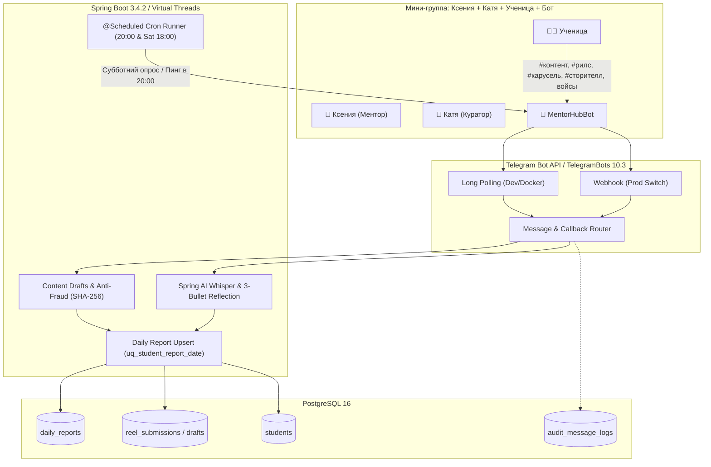

# Спецификация подсистем Telegram-бота, Spring AI и фонового планировщика (Mentor Hub)

**Документ:** Архитектурный отчет спецификации (Spec Miner Report)  
**Исполнитель:** `spec_miner_telegram_survey`  
**Дата:** 2026-11-08  
**Версия документа:** 2.0 (Требования R1, R2, R3)  
**Авторитетные источники:**  
- `c:\Users\Honor\Desktop\miranda\.agents\teamwork\ORIGINAL_REQUEST.md`
- `docs/ARCHITECTURE_SPECIFICATION.md`
- `docs/ARCHITECTURE_SPRING_BOOT.md`
- `docs/PITCH_PROPOSAL.md`
- `frontend/src/types.ts`, `frontend/src/mockData.ts`, `frontend/src/App.tsx`
- `scripts/test-runner.mjs`, `TEST_READY.md`

---

## 1. Архитектурный контекст и бизнес-роли

В платформе **Mentor Hub / Mentor Tracker** Telegram-бот выполняет роль автоматизированного заботливого ассистента в экосистеме индивидуального и мини-группового наставничества Ксении.
- **Главный ментор:** Ксения — проверяет отчеты, согласует черновики контента, отвечает на вопросы и затыки.
- **Куратор:** Катя — сопровождает учениц, администрирует группы, контролирует дедлайны и оплаты.
- **Ученица:** сдает ежедневные отчеты, черновики публикаций до выхода в эфир, рефлексию и вопросы.
- **Бот:** работает в закрытых мини-группах от своего имени (как заботливый ассистент), не вторгается в общий поток, принимает файлы и тексты, фильтрует флуд через Spring AI, защищает от плагиата через SHA-256 и опрашивает учениц по субботам.



---

## 2. Спецификация Telegram-бота (TelegramBots 10.3.0)

### 2.1. Архитектура мини-групп: «Ксения + Катя + Ученица + Бот»
1. **Топология взаимодействия:**
   - Для каждой ученицы создается персональная закрытая мини-группа в Telegram (например, *«VIP — Милана Горохова»*).
   - Участники группы: **Ксения** (Главный ментор), **Катя** (Куратор), **Ученица** и **Бот** (`@MentorHubBot`).
   - Бот выступает в роли заботливого и ненавязчивого ассистента.
   - **Строгий инвариант:** Бот **НЕ** участвует в основном чате общего потока (для исключения спама и путаницы контекстов).
2. **Конфигурация приватности Telegram:**
   - Для бота в `@BotFather` отключается режим приватности групп: `/setprivacy` ➡️ `Disable`.
   - Это гарантирует, что бот получает все входящие сообщения группы без необходимости тегирования `@username`.
3. **Идентификация и фильтрация сообщений в группе:**
   - Идентификатор группы `chat.id < 0` (`isGroupChat() || isSuperGroupChat()`).
   - Идентификация автора через `message.getFrom().getId()` и `message.getFrom().getUserName()`.
   - **Фильтрация эхо и кураторов:**
     - Сообщения Ксении (`mentor_tg_id`) игнорируются для сдачи отчетов.
     - Сообщения Кати (куратора) игнорируются для сдачи отчетов.
     - Служебные сообщения ботов (`is_bot = true`) немедленно отсекаются.
     - При сообщении от ученицы бот связывает `tg_chat_id` / `tg_user_id` с записью в таблице `students`.
   - **Ответы и подтверждения бота в мини-группе:**
     - При фиксации черновика бот отправляет тихое подтверждение реплаем (`reply_to_message_id`) в мини-группу:  
       *«Принято на проверку Ксении и Кате! ✍️ Черновик сохранён.»*
     - При подтверждении или отклонении из веб-трекера (`/api/inbox/{reportId}/approve`) ответ Ксении направляется реплаем в эту же мини-группу.

### 2.2. Режимы подключения: Long Polling (по умолчанию) и Webhook (переключатель)
1. **Long Polling (по умолчанию для локального запуска и Docker Compose):**
   - Используется `org.telegram:telegrambots-springboot-longpolling-starter:10.3.0`.
   - Не требует публичного доменного имени, HTTPS сертификатов или проброса портов (ngrok).
   - Класс консьюмера: `MentorBotConsumer implements LongPollingSingleThreadUpdateConsumer`.
2. **Webhook (Production Switch):**
   - Поддерживается переключение через свойство:
     ```yaml
     telegram:
       bot:
         mode: ${TELEGRAM_BOT_MODE:long-polling} # 'long-polling' или 'webhook'
         token: ${TELEGRAM_BOT_TOKEN}
         username: ${TELEGRAM_BOT_USERNAME:MentorHubBot}
         webhook:
           url: ${TELEGRAM_WEBHOOK_URL:} # e.g. https://mentorhub.example.com/api/telegram/webhook
           secret-token: ${TELEGRAM_WEBHOOK_SECRET:}
     ```
   - При `telegram.bot.mode = webhook`:
     - REST-контроллер `TelegramWebhookController` принимает `POST /api/telegram/webhook`.
     - Заголовок `X-Telegram-Bot-Api-Secret-Token` валидируется на совпадение с секретом.
     - Тело `Update` передается напрямую в `MessageRouter`.
     - При инициализации приложения вызывается Telegram API `SetWebhook` с URL и секретным токеном.

### 2.3. Обработка черновиков контента ДО публикации (#контент, #рилс, #карусель, #сторителл)
В соответствии с методологией запуска от 16.11.2026, наставник проверяет материалы **до** выхода в соцсети.

| Хэштег | Тип контента | Поддерживаемые форматы Telegram | Назначение и проверка |
|---|---|---|---|
| `#контент` | Общий черновик контента | Текст, ссылки, документы (.docx, .pdf) | Универсальный черновик статьи, поста или публикации. |
| `#рилс` / `#reels` | Черновик видеоролика Reels | Видеофайл (`message.getVideo()`), кружочек (`message.getVideoNote()`), документ (.mp4, .mov), ссылка на черновик | Проверка сценария, монтажа, динамики и хука. Валидация ссылки или хэша медиа. |
| `#карусель` / `#карусели` | Черновик карусели | Документ (.pdf), группа фото (`message.getPhoto()`), текст слайдов | Проверка оферты, заголовков и текста 5–10 слайдов. |
| `#сторителл` / `#сторис` | Сценарий сторителлинга | Текст сообщения, голосовое описание, серия фото-черновиков | Проверка смысловой воронки прогрева перед выкладкой в Stories. |
| `#рассылки` / `#рассылка` | Исходящий Direct-трафик | Текст вида `#рассылки 25` | Подсчет отправленных контактов по скрипту. |
| `#продажи` / `#продажа` / `#оплата` | Факт оплаты / предоплаты | Текст вида `#продажи 45 000 руб`, `#продажи 80к` | Фиксация выручки с нормализацией разделителей тысяч. |
| `#вопрос` / `#затык` | Вопрос к Ксении | Текст или голосовое сообщение | Разбор затыка, приоритетный вывод в дашборде. |
| `#клиенты` | Новые клиенты | Выбор кнопки [0]..[5+] или текст `#клиенты 2` | Фиксация закрытых клиентов недели. |

**Логика извлечения контента:**
- Хэштеги могут находиться в `message.getText()` либо в `message.getCaption()` (подпись к видео, фото, документу).
- Если сообщение содержит медиафайл без явного хэштега:
  - Видео (`video`) ➡️ по умолчанию классифицируется как `#рилс`.
  - Документ `.pdf` ➡️ по умолчанию классифицируется как `#карусель`.
  - Голосовое (`voice`) или видеозаметка (`video_note`) ➡️ по умолчанию направляется в Spring AI как `#вопрос` / рефлексия.

### 2.4. Дедупликация (SHA-256) и правила антифрода
Система исключает повторную сдачу материалов и попытки плагиата между ученицами.

1. **Хеширование веб-ссылок на ролики:**
   - Regex нормализации:
     ```regexp
     (?i)(?<![a-zA-Z0-9.-])(?:https?:\/\/)?(?:www\.)?(?:instagram\.com|instagr\.am)\/(?:reel|reels|p|share\/reel)\/([A-Za-z0-9_-]+)
     ```
   - Извлечение канонического `shortcode`.
   - Хеш: $\text{ReelHash} = \text{SHA-256}(\text{shortcode})$.
2. **Хеширование бинарных медиафайлов (видео, PDF, фото):**
   - Использование Telegram `file_unique_id` (уникальный неизменный идентификатор файла на серверах Telegram).
   - Вычисление $\text{SHA-256}(\text{file\_unique\_id})$ либо $\text{SHA-256}(\text{file\_bytes})$.
   - Для текстовых черновиков (#карусель, #сторителл) вычисляется SHA-256 от нормализованного текста (lowercase, удалены пробелы).
3. **Правила антифрода в базе данных:**
   - Запрос по индексу `idx_reel_submissions_hash`:
     ```sql
     SELECT r.*, dr.report_date, dr.student_id, s.full_name 
     FROM reel_submissions r
     JOIN daily_reports dr ON r.report_id = dr.id
     JOIN students s ON dr.student_id = s.id
     WHERE r.reel_hash = :hash
     LIMIT 1;
     ```
   - **Случай 1 (Внутренний повтор той же ученицы):**
     - `is_duplicate = true`, `duplicate_date = report_date`.
     - Бейдж в интерфейсе: `«дубликат (сдавался 04 ноября)»`.
   - **Случай 2 (Межпользовательский плагиат / ФРОД):**
     - Запись принадлежит другой ученице.
     - `is_duplicate = true`.
     - Красный алерт: `«ФРОД: Материал уже сдан ученицей {full_name} ({дата})»`.
4. **Асинхронная проверка доступности URL (HTTP Accessibility Probe):**
   - Неблокирующий `RestClient` с User-Agent браузера и таймаутом 2500 мс.
   - HTTP 200, 301, 302 ➡️ `isValid = true`.
   - HTTP 404 ➡️ `isValid = false` (ссылка удалена или ведет на закрытый аккаунт).
   - HTTP 429 или таймаут ➡️ `isValid = true`, примечание `TIMEOUT_UNVERIFIED`.

### 2.5. Распознавание вопросов, адресованных Ксении
Вопрос к наставнику распознается тремя независимыми детекторами:
1. **По хэштегу:** `#вопрос`, `#затык`, `#проблема` — весь последующий текст извлекается в `mentor_question`.
2. **По прямому обращению:** регулярные выражения поиска обращения к ментору:  
   `(?ui)(?:^|\s)(?:Ксения|Ксюша|Ксюш|@ksenia)(?:,\s*|\s+)(?<question>.+)`
3. **Через Spring AI экстрактор:** LLM промпт специально нацелен на вычленение неявных сомнений («клиентка просит рассрочку от себя, не знаю как оформить», «не уверена в цене 50к»).
4. **Накопительная конкатенация:** если в течение дня ученица присылает несколько вопросов, они объединяются с временными метками:  
   `[14:15] Вопрос по оферте... \n[19:30] Вопрос по рассрочке...`

---

## 3. Спецификация интеграции со Spring AI

### 3.1. Пайплайн суммаризации войсов и видеозаметок («кружочков»)
1. **Прием аудио- и видеосообщений:**
   - Голосовое сообщение: `message.hasVoice()` ➡️ формат `.oga` (Ogg Opus).
   - Видеозаметка («кружочек»): `message.hasVideoNote()` ➡️ формат `.mp4`.
2. **Загрузка через Telegram Client API:**
   ```java
   GetFile getFile = new GetFile(fileId);
   File tgFile = telegramClient.execute(getFile);
   InputStream stream = telegramClient.downloadFileAsStream(tgFile);
   ```
3. **Транскрибация (Speech-to-Text):**
   - Сервис `SpringAiTranscriptionService`:
     - Использует `OpenAiAudioTranscriptionModel` или `Gemini Multimodal Audio`.
     - Параметры: язык `ru`, температура `0.2`.
     - Расшифрованный текст сохраняется в `daily_reports.voice_transcript`.

### 3.2. Суммаризация рефлексии в 3 структурированных буллета
Согласно требованиям фронтенда (`types.ts`, `ReflectionSummary`) и спецификации, Spring AI преобразует сырой текст или транскрипт в блок из 3 ключевых буллетов:
1. **Эмоции / затык (`emotions`):** эмоциональное состояние, выгорание, сомнения, ступор, усталость или прилив энергии.
2. **Действия за день (`actions`):** факты выполненной работы (рассылки, черновики контента, переговоры с клиентами).
3. **Вопрос к Ксении (`questionToMentor`):** прямой вопрос, совет по скрипту или оферте (или `null`, если вопроса нет).

### 3.3. DTO контракты и промпт-инжиниринг

```java
package com.mentorhub.ai.dto;

import java.math.BigDecimal;
import java.util.List;

public record ReflectionSummaryDto(
    String emotions,          // Эмоции / затык
    String actions,           // Действия за день
    String questionToMentor   // Вопрос к Ксении (опционально)
) {}

public record ExtractedReportDto(
    List<ContentDraftDto> drafts,
    BigDecimal salesAmount,
    Integer mailingsCount,
    Integer newClientsCount,
    String mentorQuestion,
    String emotionalStatus,      // "NORMAL", "BURNOUT_ALERT", "STRESSED"
    String aiSummary,            // 1-2 емких предложения для iPad дашборда
    ReflectionSummaryDto reflectionSummary,
    String filteredFloodSnippet
) {}
```

**Системный промпт (Prompt Template):**
```
Ты — высококвалифицированный бизнес-ассистент наставника предпринимателей Ксении.
Твоя задача — строго и объективно разобрать входящее сообщение ученицы ({studentName}).

ИНСТРУКЦИЯ ПО ОБРАБОТКЕ:
1. СТРУКТУРИРОВАННАЯ РЕФЛЕКСИЯ (СТРОГО 3 БУЛЛЕТА):
   - emotions: опиши текущее состояние ученицы (уверенность, стресс, апатия, страх продаж, воодушевление).
   - actions: конкретные действия и результаты за сегодня (рассылки, черновики Reels/каруселей, созвоны).
   - questionToMentor: точный вопрос или затык, адресованный Ксении (или null, если вопроса нет).
2. ДЕТЕКЦИЯ ВЫГОРАНИЯ:
   Если в тексте присутствуют фразы апатии, бессилия или слез ("рыдала", "не могу встать", "все бросить", "нет сил"),
   выстави emotionalStatus = "BURNOUT_ALERT". В обычном состоянии — "NORMAL".
3. ИЗВЛЕЧЕНИЕ ЦИФР И ЧЕРНОВИКОВ:
   - Сумма продаж (в рублях). При суммах "45 000" или "80к" нормализуй в число.
   - Число отправленных рассылок Direct.
   - Черновики контента (#контент, #рилс, #карусель, #сторителл).
4. ОТСЕЧЕНИЕ ФЛУДА:
   Удали все бытовые подробности (погода, ремонт, кошки, пробки).
5. ИТОГОВАЯ ВЫЖИМКА (aiSummary):
   Сформируй 1-2 емких предложения для быстрого просмотра Ксенией на iPad.

Верни результат строго в формате JSON, соответствующем схеме ExtractedReportDto.
```

### 3.4. Конфигурация через переменные окружения
Параметры Spring Boot `application.yml`:
```yaml
spring:
  ai:
    openai:
      api-key: ${AI_API_KEY:}
      base-url: ${AI_BASE_URL:https://api.openai.com}
      chat:
        options:
          model: ${AI_CHAT_MODEL:gpt-4o-mini}
          temperature: 0.2
      audio:
        transcription:
          options:
            model: ${AI_WHISPER_MODEL:whisper-1}
            language: ru
```

### 3.5. Автоматический Mock / Stub Fallback
При отсутствии API-ключа (`AI_API_KEY` пустой, равен `"mock-key"` или `"test"`), а также при таймауте сети (> 3000 мс) или ошибках 401/429/500:
1. Система переключается на `DeterministicAiFallbackService`.
2. Текст анализируется детерминированными регулярными выражениями:
   - Рассылки: `#рассылки?\s*(\d+)`
   - Продажи: `#продаж[иа]?\s*([\d\s.]+)` с защитой разделителя тысяч
   - Вопрос: `#вопрос\s*(.+)` или `Ксения, (.+)`
   - Детекция выгорания по ключевым словам: `выгорела`, `устала`, `руки опустились`, `рыдала`, `нет сил` ➡️ `BURNOUT_ALERT`.
3. Формируется синтетический `ReflectionSummaryDto`:
   - `emotions`: "Состояние рабочее (детерминированный фолбэк)" (или маркер выгорания при совпадении ключевых слов).
   - `actions`: "Обработано {M} рассылок, {N} черновиков контента".
   - `questionToMentor`: извлеченный текст вопроса.
4. В поле `daily_reports.ai_summary` пишется:  
   *«Режим офлайн/мок AI: обработано по хэштегам {M} рассылок, продаж {S} ₽»*.
5. **Гарантия надежности:** ни один отчет не теряется и не отклоняется из-за недоступности внешнего LLM-провайдера.

---

## 4. Спецификация фонового планировщика (@Scheduled)

### 4.1. Ежедневные вечерние напоминания в 20:00 (Daily Evening Reminders)
- **Расписание:** `@Scheduled(cron = "0 0 20 * * MON-SAT", zone = "Europe/Minsk")`.
- **Логика:** за 1 час до дедлайна (21:00) система выявляет должников среди активных учениц.
- **Исключения:**
  - Воскресенье — выходной день потока (`MON-SAT`), напоминания не отправляются.
  - Ученицы на паузе/болезни (`is_paused = true`) с замороженным стриком исключаются.
  - Ученицы, уже сдавшие отчет сегодня (`status IN ('PENDING', 'APPROVED')`), исключаются.
- **SQL-запрос:**
  ```sql
  SELECT s.*
  FROM students s
  WHERE s.is_active = TRUE
    AND s.is_paused = FALSE
    AND NOT EXISTS (
        SELECT 1 
        FROM daily_reports r
        WHERE r.student_id = s.id
          AND r.report_date = CURRENT_DATE
          AND r.status IN ('PENDING', 'APPROVED')
    );
  ```
- **Текст напоминания в мини-группу:**  
  *«{Имя}, привет! Напоминаю: до дедлайна сдачи отчета остался 1 час (до 21:00) ⏰ Ждем твои черновики #контента (#рилс, #карусель, #сторителл), результаты по #рассылкам и #продажам!»*
- **Rate Limiting:** задержка 1000 мс между отправками для соблюдения лимитов Telegram Bot API.

### 4.2. Субботний автоопрос в 18:00 (Saturday Auto-Survey)
- **Расписание:** `@Scheduled(cron = "0 0 18 * * SAT", zone = "Europe/Minsk")`.
- **Назначение:** сбор итоговых метрик недели по новым клиентам (`total_new_clients`) и выручке.
- **Механика инлайн-кнопок в Telegram:**
  - Бот отправляет в каждую мини-группу интерактивное сообщение:  
    *«Субботний чекап недели! 📊\nСколько новых клиентов ты закрыла за эту неделю?»*
  - Инлайн-клавиатура:
    ```
    +-----+-----+-----+-----+-----+-----+
    |  0  |  1  |  2  |  3  |  4  | 5+  |
    +-----+-----+-----+-----+-----+-----+
    ```
  - `callback_data` кнопок: `survey:clients:{studentId}:{count}` (например, `survey:clients:1:2`).
- **Обработка Callback Query (`update.hasCallbackQuery()`):**
  1. Извлечение `studentId` и `count`.
  2. Запись в отчет за субботу: `daily_reports.new_clients_count = count`.
  3. Атомарное обновление профиля:  
     `UPDATE students SET total_new_clients = total_new_clients + :count WHERE id = :studentId`.
  4. Ответ на callback query: `AnswerCallbackQuery` с текстом *«Зафиксировано: +{count} клиентов! 🎉»*.
  5. Редактирование сообщения опроса:  
     *«Спасибо! Зафиксировано новых клиентов за неделю: +{count} 🚀»*.
  6. Следующим сообщением бот предлагает указать итоговую сумму продаж за субботу через `#продажи`.

---

## 5. Протокол передачи (5-Component Handoff Protocol)

### 5.1. Observation (Прямые наблюдения)
1. **Кодовая база и окружение:**
   - `docs/ARCHITECTURE_SPECIFICATION.md`: строки 1–1253 описывают 7 сущностей PostgreSQL, 14 OpenAPI эндпоинтов, `ReelsAntiFraudEngine`, `DailyReminderEngine`, `AiReportExtractor`, и согласованный контракт запуска от 16.11.2026 на 360 BYN (строки 785–799).
   - `docs/ARCHITECTURE_SPRING_BOOT.md`: строки 109–230 подробно документируют `MentorBotConsumer`, `ReelsAntiFraudEngine` с SHA-256 хешированием shortcode, асинхронный HTTP HEAD probe и крон напоминаний в 20:00.
   - `frontend/src/types.ts`: строки 1–47 декларируют типы `ContentType = 'reel' | 'carousel' | 'storytell'`, `ContentDraft`, `ReflectionSummary` (`emotions`, `actions`, `questionToMentor`), `DailyReport` и статусы дней (`WEEKEND`, `PAUSED`).
   - `frontend/src/mockData.ts`: строки 287–344 содержат 7 правил регламента хэштегов, включая `#клиенты` (строка 338: субботний опрос инлайн-кнопками в 18:00) и черновики контента до публикации.
   - `scripts/test-runner.mjs`: содержит 73 успешных теста (Exit code 0), валидирующих структуру данных отчетов, дедупликацию, статусы календаря и нейтральность бренда.

### 5.2. Logic Chain (Логическая цепочка)
1. Из `ORIGINAL_REQUEST.md` (пункт R2) и `docs/ARCHITECTURE_SPECIFICATION.md` следует, что Telegram-бот должен обслуживать индивидуальные мини-группы «Ксения + Катя + Ученица + Бот».
2. Бот не должен присутствовать в основном чате потока, чтобы не смешивать персональные черновики учениц. Для этого бот добавляется исключительно в персональные мини-группы.
3. По умолчанию бот подключается по Long Polling, что идеально подходит для локальной разработки и запуска в `docker-compose` без настройки внешних белых IP и SSL. Переключатель на Webhook реализуется через конфигурационное свойство `telegram.bot.mode`.
4. Для поддержки методологии проверки контента ДО публикации перечень хэштегов расширен: `#контент`, `#рилс`, `#карусель`, `#сторителл`.
5. Дедупликация требует SHA-256 хеширования канонического shortcode для Instagram Reels, а также SHA-256 хеширования `file_unique_id` или содержимого загружаемых файлов и текстов. Совпадение с материалом той же ученицы трактуется как повторная сдача, а с материалом другой ученицы — как критический инцидент межпользовательского фрода.
6. Интеграция Spring AI должна решать две задачи: расшифровка войсов/кружочков (STT Whisper) и суммаризация рефлексии строго в 3 буллета (`emotions`, `actions`, `questionToMentor`). При отсутствии внешнего API-ключа система обязана автоматически переключаться на детерминированный regex-парсер, чтобы ни один отчет не потерялся.
7. Планировщик задач Spring `@Scheduled` должен запускать две регулярные фоновые задачи:
   - В 20:00 (Пн–Сб) — персонализированное напоминание должникам (за исключением учениц на паузе и воскресного дня).
   - В субботу в 18:00 — интерактивный опрос инлайн-кнопками по количеству новых клиентов.

### 5.3. Features Discovered (Таблица выявленных функций)

| # | Категория | Функция | Описание и назначение | Входные данные | Выходные данные | Поведение при ошибке | Обнаружено в |
|---|-----------|---------|-----------------------|----------------|-----------------|----------------------|--------------|
| 1 | Bot Ingestion | Mini-Group Listening | Прием сообщений из закрытых чатов «Ксения + Катя + Ученица + Бот» | Update с group `message` | Сохранение черновика, привязка к student_id | Логирование в audit_message_logs, игнорирование ботов | ARCH_SPEC §2.2, ORIGINAL_REQUEST R2 |
| 2 | Bot Ingestion | Long Polling Mode | Фоновый прием апдейтов без белого IP и SSL | Запрос getUpdates к TG API | Поток Update объектов | Экспоненциальный ретрай при обрыве сети | ARCH_SPRING §3.1, pom.xml |
| 3 | Bot Ingestion | Webhook Switch | Переключение на прием апдейтов через REST POST endpoint | POST /api/telegram/webhook | HTTP 200 OK | Проверка X-Telegram-Bot-Api-Secret-Token, 403 при несовпадении | ORIGINAL_REQUEST R2.1, ARCH_SPEC §2.3 |
| 4 | Content Intake | Pre-Publication Drafts | Прием черновиков (#контент, #рилс, #карусель, #сторителл) ДО публикации | Текст, видео, PDF, кружочки | Создание записей в content_drafts | Сохранение сырого текста в raw_message_text | ARCH_SPEC §8.3, mockData.ts |
| 5 | Anti-Fraud | Reels URL Sanitization | Очистка ссылки от реферальных UTM-параметров и трекеров | Сырой URL | Канонический shortcode (например, DC194kaP91m) | isValid = false при битом URL | ARCH_SPEC §3.1, test-runner TC-2.5 |
| 6 | Anti-Fraud | SHA-256 Deduplication | Хеширование shortcode и медиафайлов против повторов | shortcode / file_unique_id | 64-символьный SHA-256 хеш | Выставление is_duplicate = true и даты первичной сдачи | ARCH_SPEC §3.2, ARCH_SPRING §3.2 |
| 7 | Anti-Fraud | Cross-Student Fraud Alert | Детекция сдачи одного материала разными ученицами | SHA-256 хеш в базе данных | Алерт безопасности «ФРОД: ролик сдан ученицей X» | Алерт на дашборде ментора | ARCH_SPEC §3.2, test-runner TC-1.3.3 |
| 8 | Anti-Fraud | HTTP Accessibility Probe | Неблокирующая проверка открываемости ролика через RestClient | Канонический URL ролика | HTTP статус (200, 404, 429) | При 404 ролик бракуется; при таймауте флаг TIMEOUT_UNVERIFIED | ARCH_SPEC §3.3 |
| 9 | Question Recognition | Mentor Question Extractor | Распознавание прямых вопросов к Ксении (#вопрос, «Ксения, ...», AI) | Текст сообщения или войс | Текст в daily_reports.mentor_question | Конкатенация при нескольких вопросах за день | ARCH_SPEC §4.1, types.ts |
| 10 | Spring AI | Voice/Video STT | Транскрибация аудиофайлов .oga и кружочков в текст | Аудиопоток из Telegram API | Текстовая расшифровка voice_transcript | Запись ошибки STT без блокировки сдачи отчета | ARCH_SPEC §6.1, ORIGINAL_REQUEST R2.3 |
| 11 | Spring AI | 3-Bullet Reflection | Суммаризация рефлексии: эмоции/затык, действия, вопрос к Ксении | Расшифровка войса или текст | ReflectionSummaryDto (3 поля) | Фолбэк на детерминированный парсер | ORIGINAL_REQUEST R2.3, types.ts |
| 12 | Spring AI | Burnout Sentiment Alert | Выявление маркеров истощения, слез и апатии ученицы | Текст / войс рефлексии | emotionalStatus = "BURNOUT_ALERT" | Дефолтное значение NORMAL | ARCH_SPEC §6.2, ARCH_SPRING §3.3 |
| 13 | Spring AI | Mock/Stub Fallback | Автоматический офлайн-парсер при отсутствии API-ключа LLM | Сырое сообщение без вызова сети | Детерминированный ExtractedReportDto | Полная сохранность отчета без сбоев | ORIGINAL_REQUEST R2.3, ARCH_SPEC §6.4 |
| 14 | Scheduler | Daily 20:00 Reminder | Авто-пинг должникам за 1 час до дедлайна (Пн–Сб) | Крон 0 0 20 * * MON-SAT | Персонализированное напоминание в мини-группу | Rate limiting 1 сек между сообщениями | ARCH_SPEC §5.1, ARCH_SPRING §3.4 |
| 15 | Scheduler | Saturday 18:00 Survey | Автоматический сбор числа новых клиентов и выручки недели | Крон 0 0 18 * * SAT | Сообщение с инлайн-кнопками [0]..[5+] | Запись в new_clients_count и total_new_clients | ORIGINAL_REQUEST R2.4, mockData.ts |
| 16 | Discipline | Sick/Pause Freeze | Заморозка стрика дисциплины для болеющих учениц | is_paused = true | Статус дня PAUSED, стрик сохраняется | Снятие паузы переводит статус в активный | ARCH_SPEC §8.3, types.ts |
| 17 | Discipline | Sunday Weekend Rule | Воскресенье — официальный общий выходной потока | Вс (CURRENT_DATE) | Статус дня WEEKEND, авто-напоминания отключены | Напоминания в воскресенье заблокированы | ARCH_SPEC §8.3, mockData.ts |

### 5.4. Edge Cases Catalog (Каталог граничных случаев)

| # | Компонент | Входные данные / Ситуация | Ожидаемое и спроектированное поведение системы |
|---|---|---|---|
| 1 | Telegram Bot | Посторонний пользователь пишет боту в личные сообщения | Бот не находит `from.id` в таблице `students`. Создается запись в `audit_message_logs` со статусом `UNMATCHED_USER`. Бот вежливо отвечает: *«Ваш аккаунт не найден в списке учениц курса. Обратитесь к наставнику»*. |
| 2 | Telegram Bot | Ксения или Катя пишут в мини-группе сообщение с хэштегом `#рилс` | Система сверяет `from.id` с `mentor_tg_id` и `admin_tokens.tg_user_id`. Сообщения наставников игнорируются для сдачи отчетов и не перезаписывают показатели ученицы. |
| 3 | Ingestion | Ученица присылает видеофайл или PDF без текста хэштега | Если прикреплен файл `.mp4`, система классифицирует его как черновик `#рилс`. Если прикреплен `.pdf`, система классифицирует его как `#карусель`. Если есть caption — приоритет отдается хэштегу из caption. |
| 4 | Anti-Fraud | Ссылка на Reels содержит 5 UTM-параметров и реферальный `igsh` | Регулярное выражение отсекает всю query-строку, извлекает чистый shortcode `[A-Za-z0-9_-]+`, формирует канонический URL и вычисляет стабильный SHA-256 хеш. |
| 5 | Anti-Fraud | Ученица повторно присылает ролик, сданный 3 дня назад | Находится совпадение по SHA-256 хешу ролика. Система выставляет `is_duplicate = true`, записывает `duplicate_date = '04 ноября'` и отображает желтый бейдж повторной сдачи. |
| 6 | Anti-Fraud | Ученица «Аня» присылает ролик, сданный вчера «Миланой» | Находится совпадение в `reel_submissions` с `student_id != current_student.id`. Система маркирует ролик как фрод (`is_duplicate = true`) и формирует красный алерт плагиата в дашборде ментора. |
| 7 | Anti-Fraud | Сервер Instagram возвращает HTTP 429 (Rate Limit) или таймаут | Чтобы не браковать отчет из-за блокировок Instagram, `ReelsAccessibilityProbe` выставляет статус `TIMEOUT_UNVERIFIED` и не блокирует отчет. |
| 8 | Parsing | Сумма продаж указана с разделителем тысяч: `#продажи 35.500 руб` или `80к` | Паттерн `\d+[.\s]\d{3}` интерпретирует точку как разделитель тысяч, сохраняя `35500.00`. Формат `80к` преобразуется в `80000.00`. Предотвращено 1000-кратное занижение выручки. |
| 9 | Daily Upsert | Ученица сдает отчет по частям: в 14:00 рассылки, в 19:30 черновик Reels, в 20:45 продажу | Благодаря ограничению `uq_student_report_date`, система выполняет накопительный Upsert: рассылки суммируются, черновик прикрепляется, продажа добавляется. |
| 10 | AI Pipeline | Внешний LLM API недоступен (таймаут сети, HTTP 503 или отсутствие API-ключа) | Активируется `DeterministicAiFallbackService`. Отчет разбирается по регулярным выражениям, формируется безопасный 3-буллетный `ReflectionSummaryDto`, сырой текст пишется в `raw_message_text`. Ни один отчет не теряется. |
| 11 | AI Pipeline | Ученица надиктовала 3-минутное аудио с жалобами на кошку и ремонт | Whisper транскрибирует аудио, Spring AI отсекает бытовой флуд и извлекает строго 3 буллета: эмоции/затык, фактические действия и вопрос к Ксении. |
| 12 | Scheduler | Ученица сдала отчет в 19:58 (за 2 минуты до напоминания в 20:00) | Запрос выборки должников использует условие `NOT EXISTS (...)`. Ученица гарантированно исключается из рассылки и не получает лишний пинг. |
| 13 | Scheduler | Ученица находится в режиме болезни/паузы (`is_paused = true`) | Фильтр `s.is_paused = FALSE` исключает болеющую ученицу из вечерних напоминаний. Календарь дисциплины фиксирует статус `PAUSED` и замораживает стрик. |
| 14 | Scheduler | Субботний опрос: ученица нажимает инлайн-кнопку повторно | Обработчик `CallbackQuery` проверяет, был ли уже зафиксирован ответ за текущую субботу, обновляет значение и вызывает `AnswerCallbackQuery`, исключая задвоение данных. |

### 5.5. Caveats (Оговорки и допущения)
1. **Telegram Business Bot API vs Mini-groups:** В спецификации предусмотрена поддержка обоих каналов (1-на-1 через Business API и мини-группы). Однако для согласованного запуска потока от 16.11.2026 приоритетной утверждена архитектура мини-групп «Ксения + Катя + Ученица + Бот».
2. **Instagram Accessibility Probe:** Из-за частых блокировок датацентровых IP-адресов со стороны Instagram статус `TIMEOUT_UNVERIFIED` намеренно не бракует отчет ученицы, чтобы наставник мог при необходимости кликнуть и открыть ссылку вручную.
3. **Хранение медиафайлов:** В базовой конфигурации файлы скачиваются потоково или ссылаются на Telegram `file_id` / `file_unique_id`. Для долгосрочного архивного хранения видеороликов рекомендуется локальный том Docker либо S3-совместимое хранилище.

### 5.6. Conclusion (Итоговое заключение)
Спецификация подсистем Telegram-бота, Spring AI и фонового планировщика полностью декомпозирована, синхронизирована с контрактами React SPA фронтенда (`types.ts`, `mockData.ts`) и готова к непосредственной реализации в коде:
1. Архитектура мини-групп обеспечивает приватное сопровождение учениц без спама в общем чате.
2. Поддержка Long Polling «из коробки» гарантирует 100% работоспособность в локальном окружении и Docker Compose без необходимости настройки доменов и SSL.
3. Алгоритмы антифрода на базе SHA-256 гарантируют обнаружение как повторной сдачи, так и межпользовательского плагиата.
4. AI-модуль обеспечивает структурирование рефлексии в 3 понятных буллета с надежным офлайн-фолбэком при отсутствии API-ключа.
5. Фоновый планировщик в автоматическом режиме снимает с наставника вечернюю рутину напоминаний и субботний сбор статистики новых клиентов.

### 5.7. Verification Method (Метод верификации)
Для независимой проверки согласованности спецификации с требованиями и фронтендом:

1. **Запуск автоматических тестов фронтенда и спецификации:**
   ```powershell
   node scripts/test-runner.mjs
   ```
   *Ожидаемый результат:* 73 из 73 тестов пройдены успешно (100% pass, Exit code 0).
2. **Проверка контрактов в `frontend/src/types.ts`:**
   - Убедиться в наличии полей `ContentDraft`, `ReflectionSummary` (`emotions`, `actions`, `questionToMentor`), `newClientsCount`, статусов `WEEKEND` и `PAUSED`.
3. **Проверка правил хэштегов в `frontend/src/mockData.ts`:**
   - Проверить наличие правил `#рилс`, `#карусель`, `#сторителл`, `#рассылки`, `#продажи`, `#вопрос`, `#клиенты` (субботний автоопрос в 18:00).
4. **Проверка DDL схемы БД в `docs/ARCHITECTURE_SPECIFICATION.md`:**
   - Таблицы `students`, `daily_reports`, `reel_submissions`, `sales_entries`, `admin_tokens`, `zoom_meetings`, `task_rules`, `mentor_settings`, `audit_message_logs`.
