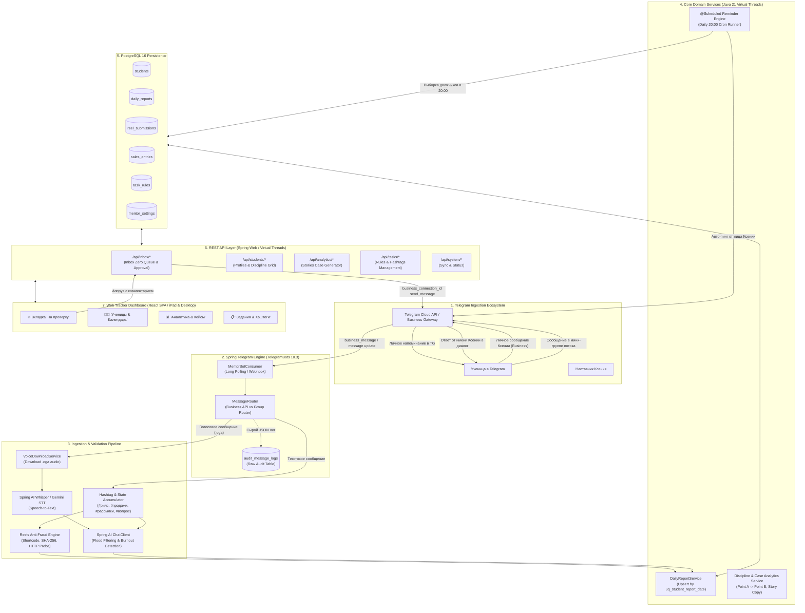

# Mentor Hub / Mentor Tracker — Исчерпывающая архитектурная спецификация бэкенда и Telegram-бота

**Документ:** Техническая спецификация серверной части и автоматизации Telegram  
**Версия спецификации:** 2.0 (Требования R2 & R3)  
**Брендинг:** Mentor Hub / Mentor Tracker (строго нейтральное оформление без упоминания внешних брендов)  
**Целевой наставник:** Ксения (индивидуальное наставничество предпринимателей и экспертов)  
**Стек:** Java 21 LTS (Virtual Threads) / Java 25, Spring Boot 4.x / Spring AI 2.x (с документированным Production Fallback на Spring Boot 3.4.x / Spring AI 1.x), TelegramBots 10.3.0, PostgreSQL 16+, React SPA.

---

## 1. Архитектурный контекст и бизнес-цели

### 1.1. Проблематика и назначение платформы
В процессе наставничества предпринимателей и экспертов ключевым фактором достижения финансового результата («Точка А ➡️ Точка Б») является ежедневная регулярность выполнения ключевых действий:
- Публикация продающих видеороликов (Instagram Reels);
- Проведение исходящих касаний и рассылок целевой аудитории;
- Фиксация оформленных заявок и сумм продаж;
- Разрешение профессиональных вопросов и затыков с наставником.

**Главные боли наставника Ксении до внедрения платформы:**
1. **Колоссальные потери времени:** Ручной сбор и разбор отчетов от 15–20 учениц занимает от 1.5 до 2.5 часов ежедневно.
2. **Флуд и эмоциональное выгорание в чатах:** Ученицы смешивают бытовые жалобы («устала, полдня лежала, погода плохая») с фактическими показателями, из-за чего наставнику трудно вычленить цифры.
3. **Обман и дубликаты Reels (фрод):** Сдача старых ссылок на ролики, сданных неделю назад, либо ссылок на закрытые аккаунты / удаленные ролики.
4. **Нарушение дисциплины сдачи:** Массовая сдача отчетов задним числом («сдам всё в воскресенье ночью»), что разрушает методологию трекинга.
5. **Сложность упаковки кейсов:** Подсчет роста дохода, кратного множителя (х2, х5) и динамики среднего чека для Instagram Stories требует ручного ведения разрозненных таблиц.

**Архитектурное решение Mentor Hub:**
Двухконтурная платформа:
1. **Фоновый Telegram-сервис:** Незаметный сбор данных в Telegram через **Telegram Business Bot API** (в личных чатах учениц с Ксенией) либо через **мини-группы потока**, с автоматической валидацией Reels, SHA-256 защитой от дублей, AI-фильтрацией флуда, распознаванием голосовых сообщений (Whisper/Gemini) и авто-напоминаниями в 20:00.
2. **Веб-трекер наставника (React SPA):** Дашборд для iPad и десктопа с принципом «Inbox Zero» для моментального согласования отчетов, интерактивным календарем дисциплины (Пн–Вс) и генератором готовых продающих кейсов для сторис.

---

### 1.2. Сквозная архитектурная диаграмма взаимодействия



---

## 2. Архитектура Telegram-бота (Dual-Channel Ingestion Engine)

Серверная часть спроектирована с поддержкой двух параллельных каналов сбора отчетов, что позволяет гибко адаптироваться под организационный формат наставника.

### 2.1. Механика 1: Личные чаты через Telegram Business Bot API (`business_message`)
Telegram Business API (внедрен в Telegram Bot API 7.2+) позволяет подключить корпоративного бота к личному аккаунту наставника Ксении без раскрытия сторонних интерфейсов для учениц.

1. **Подключение чат-бота к аккаунту:**
   - Наставник Ксения открывает в клиенте Telegram: *Настройки ➡️ Telegram Business ➡️ Чат-боты*.
   - Выбирает бота платформы `MentorHubBot` и предоставляет ему права: управление сообщениями и право отвечать (`can_reply = true`).
   - Telegram отправляет на сервер апдейт `Update` с полем `business_connection`:
     ```json
     {
       "update_id": 10001,
       "business_connection": {
         "id": "bc_998877a1b2c3d4",
         "user": { "id": 11223344, "is_bot": false, "first_name": "Ксения" },
         "user_chat_id": 11223344,
         "date": 1731000000,
         "can_reply": true,
         "is_enabled": true
       }
     }
     ```
   - Бэкенд сохраняет идентификатор подключения `business_connection_id` в таблице `mentor_settings`.

2. **Прием входящих отчетов учениц (`business_message`):**
   - Ученица пишет отчет в свой привычный личный чат с наставником Ксенией.
   - Telegram направляет вебхук/лонг-поллинг апдейт `business_message`:
     - `message.getBusinessConnectionId()` содержит актуальный ID связи.
     - `message.getFrom().getId()` содержит Telegram ID ученицы.
     - `message.getChat().getId()` — персональный чат диалога.
   - Бот считывает сообщение абсолютно прозрачно для ученицы.

3. **Отправка обратной связи от лица наставника:**
   - Когда Ксения одобряет отчет в веб-интерфейсе и вводит комментарий («Отличная работа по рассылкам! Договор оформи по шаблону №2»), бэкенд формирует запрос:
     ```java
     SendMessage sendMsg = SendMessage.builder()
         .businessConnectionId(settings.getBusinessConnectionId())
         .chatId(student.getTgChatId().toString())
         .text(replyText)
         .build();
     telegramClient.execute(sendMsg);
     ```
   - Сообщение отправляется в диалог **напрямую от имени аккаунта Ксении**, сохраняя эффект премиального личного сопровождения.

### 2.2. Механика 2: Мини-группы потока (Group Chat Ingestion)
Для тарифов группового наставничества отчеты могут сдаваться в закрытые группы (например, «VIP Поток Ноябрь»):
1. Бот добавляется администратором в группу.
2. В `@BotFather` для бота отключается Privacy Mode (`/setprivacy ➡️ Disable`), благодаря чему бот получает все входящие сообщения группы без необходимости прямого тегирования `@username`.
3. При поступлении сообщения апдейт приходит как стандартный `message` с отрицательным `chat.id` группы.
4. `MessageRouter` определяет ученицу по `message.getFrom().getId()` или `message.getFrom().getUserName()`.
5. Ответы из веб-трекера направляются в группу реплаем (`reply_to_message_id`) либо в личные сообщения ученицы.

### 2.3. Реализация маршрутизатора сообщений (Java)

```java
package com.mentorhub.bot.consumer;

import com.mentorhub.bot.model.ChatSourceType;
import com.mentorhub.bot.service.MessageRouter;
import org.slf4j.Logger;
import org.slf4j.LoggerFactory;
import org.springframework.stereotype.Component;
import org.telegram.telegrambots.longpolling.util.LongPollingSingleThreadUpdateConsumer;
import org.telegram.telegrambots.meta.api.objects.Update;
import org.telegram.telegrambots.meta.api.objects.message.Message;

@Component
public class MentorBotConsumer implements LongPollingSingleThreadUpdateConsumer {

    private static final Logger log = LoggerFactory.getLogger(MentorBotConsumer.class);
    private final MessageRouter messageRouter;
    private final MentorSettings mentorSettings;

    public MentorBotConsumer(MessageRouter messageRouter, MentorSettings mentorSettings) {
        this.messageRouter = messageRouter;
        this.mentorSettings = mentorSettings;
    }

    @Override
    public void consume(Update update) {
        try {
            if (update.hasBusinessConnection()) {
                messageRouter.handleBusinessConnection(update.getBusinessConnection());
                return;
            }

            if (update.hasBusinessMessage()) {
                Message msg = update.getBusinessMessage();
                // Фильтрация эхо: игнорируем исходящие сообщения самого наставника Ксении
                if (msg.getFrom() != null && msg.getFrom().getId().equals(mentorSettings.getMentorTgId())) {
                    log.debug("Игнорирование исходящего сообщения наставника: msgId={}", msg.getMessageId());
                    return;
                }
                String connId = msg.getBusinessConnectionId();
                messageRouter.routeIncomingMessage(msg, connId, ChatSourceType.BUSINESS_1ON1);
                return;
            }

            if (update.hasEditedBusinessMessage()) {
                Message msg = update.getEditedBusinessMessage();
                if (msg.getFrom() != null && msg.getFrom().getId().equals(mentorSettings.getMentorTgId())) {
                    return;
                }
                String connId = msg.getBusinessConnectionId();
                messageRouter.routeIncomingMessage(msg, connId, ChatSourceType.BUSINESS_1ON1_EDITED);
                return;
            }

            if (update.hasMessage()) {
                Message msg = update.getMessage();
                ChatSourceType sourceType = msg.getChat().isGroupChat() || msg.getChat().isSuperGroupChat()
                        ? ChatSourceType.MINI_GROUP
                        : ChatSourceType.DIRECT_BOT;
                messageRouter.routeIncomingMessage(msg, null, sourceType);
            }
        } catch (Exception ex) {
            log.error("Критическая ошибка обработки Update ID: {}", update.getUpdateId(), ex);
        }
    }
}
```

---

## 3. Антифрод-движок Reels (Reels Anti-Fraud Engine)

Одной из центральных задач системы является предотвращение недобросовестной сдачи отчетов (повторные ссылки, чужие ролики, недействительные ссылки).

### 3.1. Нормализация URL и извлечение канонического shortcode
Ссылки на Instagram Reels в пользовательских сообщениях поступают в самых разнообразных вариациях (с мобильных клиентов, с реферальными хвостами `?igsh=...`, короткими доменами `instagr.am` или из меню «Поделиться» `/share/reel/`).

**Каноническое регулярное выражение:**
```regexp
(?i)(?<![a-zA-Z0-9.-])(?:https?:\/\/)?(?:www\.)?(?:instagram\.com|instagr\.am)\/(?:reel|reels|p|share\/reel)\/([A-Za-z0-9_-]+)
```

**Алгоритм нормализации:**
1. Поиск совпадений в тексте сообщения.
2. Выделение группы захвата `group(1)` — буквенно-цифрового идентификатора (`shortcode`).
3. Формирование канонического адреса: `https://www.instagram.com/reel/{shortcode}/`.
4. Полное отсечение всех параметров строки запроса (`query string`), фрагментов и трекеров.

### 3.2. Хеширование и сквозная дедупликация (ReelsAntiFraudEngine & SHA-256)
Для моментального поиска совпадений вычисляется криптографический хеш в сервисе `ReelsAntiFraudEngine`:
```java
@Service
public class ReelsAntiFraudEngine {
    public String calculateHash(String shortcode) {
        return DigestUtils.sha256Hex(shortcode);
    }
}
```
$$\text{ReelHash} = \text{SHA-256}(\text{shortcode})$$

При поступлении ролика бэкенд выполняет атомарную проверку по базе данных:
```sql
SELECT r.id, r.report_id, dr.report_date, s.id AS student_id, s.full_name
FROM reel_submissions r
JOIN daily_reports dr ON r.report_id = dr.id
JOIN students s ON dr.student_id = s.id
WHERE r.reel_hash = :hash
ORDER BY r.checked_at ASC
LIMIT 1;
```

**Реакция системы на обнаружение совпадения:**
- **Случай А (Внутренний повтор):** Если найденная запись принадлежит **той же ученице**:
  - `is_duplicate = true`, `duplicate_date = report_date`.
  - В отчете отображается желтый бейдж: `«Повторная сдача: ролик сдавался вами ранее {дата}»`.
- **Случай Б (Межпользовательский антифрод):** Если ролик сдавался **другой ученицей**:
  - `is_duplicate = true`, формируется системный инцидент безопасности.
  - В отчете на дашборде наставника выставляется красный алерт: `«ФРОД: Ролик уже был сдан ученицей {full_name} ({дата})!»`.

### 3.3. Асинхронный HTTP HEAD/GET Accessibility Probe
Чтобы исключить сдачу несуществующих ссылок или роликов из приватных закрытых профилей, бэкенд выполняет неблокирующую проверку доступности через виртуальный поток Java:

```java
package com.mentorhub.validation.reels;

import org.slf4j.Logger;
import org.slf4j.LoggerFactory;
import org.springframework.http.HttpHeaders;
import org.springframework.http.HttpStatusCode;
import org.springframework.stereotype.Service;
import org.springframework.web.client.RestClient;

import java.time.Duration;

@Service
public class ReelsAccessibilityProbe {

    private static final Logger log = LoggerFactory.getLogger(ReelsAccessibilityProbe.class);
    private static final String BROWSER_USER_AGENT = 
        "Mozilla/5.0 (Windows NT 10.0; Win64; x64) AppleWebKit/537.36 (KHTML, like Gecko) Chrome/128.0.0.0 Safari/537.36";

    private final RestClient restClient;

    public ReelsAccessibilityProbe() {
        this.restClient = RestClient.builder()
            .defaultHeader(HttpHeaders.USER_AGENT, BROWSER_USER_AGENT)
            .defaultHeader(HttpHeaders.ACCEPT_LANGUAGE, "ru-RU,ru;q=0.9,en-US;q=0.8,en;q=0.7")
            .build();
    }

    public ProbeResult verifyAccessibility(String canonicalUrl) {
        try {
            var response = restClient.get()
                .uri(canonicalUrl)
                .retrieve()
                .toBodilessEntity();

            HttpStatusCode status = response.getStatusCode();
            if (status.is2xxSuccessful() || status.value() == 301 || status.value() == 302) {
                return new ProbeResult(true, status.value(), null);
            }
            return new ProbeResult(false, status.value(), "Ссылка возвращает статус: " + status.value());
        } catch (org.springframework.web.client.HttpClientErrorException.NotFound ex) {
            return new ProbeResult(false, 404, "Ролик не найден или удален (404)");
        } catch (org.springframework.web.client.HttpClientErrorException.TooManyRequests ex) {
            log.warn("Instagram Rate Limit 429 при проверке {}", canonicalUrl);
            return new ProbeResult(true, 429, "TIMEOUT_UNVERIFIED: Превышен лимит запросов сети");
        } catch (Exception ex) {
            log.warn("Таймаут или сетевой сбой при валидации Reels {}: {}", canonicalUrl, ex.getMessage());
            // Не бракуем отчет из-за временных сетевых неполадок
            return new ProbeResult(true, 0, "TIMEOUT_UNVERIFIED");
        }
    }

    public record ProbeResult(boolean isValid, int httpStatus, String note) {}
}
```

---

## 4. Хэштег-движок и суточный накопительный агрегатор

### 4.1. Регламентные хэштеги и гибкий парсинг
Ученицы присылают отчеты в свободной форме, структурируя ключевые блоки регламентными хэштегами:
- `#рилс` / `#reels` / `#рилсы` — публикация ролика.
- `#продажи` / `#продажа` / `#оплата` — сумма дохода. Поддерживается интеллектуальное распознавание форматов:
  - `#продажи 45 000 руб` ➡️ `45000.00`
  - `#продажи 80к (наставничество)` ➡️ `80000.00`
  - `#оплата: 35.500 рублей` ➡️ `35500.00` (нормализация разделителя тысяч `\d+[.\s]\d{3}`)
  - `#продажи 1500$` ➡️ автоматический расчет по курсу или сохранение валюты.
  > **Нормализация финансовых сумм (Russian Locale Grouping Separator):**  
  > При обработке сумм продаж паттерны вида `\d+[.\s]\d{3}` (например, `35.500 руб`, `45 000 руб`, `120.000`) интерпретируют точку или пробел как разделитель тысяч (grouping separator), а не десятичную дробь. Это предотвращает 1000-кратное занижение выручки учениц при вычислении Точки Б.
- `#рассылки` / `#рассылка` — целое число отправленных сообщений:
  - `#рассылки 25` ➡️ `25`
- `#вопрос` / `#затык` / `#проблема` — текст вопроса к наставнику. Весь последующий блок сообщения сохраняется в поле `mentor_question`.

### 4.2. Накопительный Upsert-агрегатор суточного отчета
Ученицы часто сдают отчет частями: в 13:00 отправляют ссылку на смонтированный ролик, в 17:00 пишут про 15 рассылок, а в 20:30 фиксируют закрытие сделки. 

Схема базы данных содержит уникальное ограничение:
```sql
CONSTRAINT uq_student_report_date UNIQUE (student_id, report_date)
```

**Логика агрегации при поступлении нового сообщения за текущий день:**
1. Бэкенд ищет существующий отчет `daily_reports` за `report_date = CURRENT_DATE`.
2. Если отчет не существует — создается новая запись со статусом `PENDING`.
3. Если отчет уже существует:
   - `mailings_count = mailings_count + new_mailings` (накопительное суммирование).
   - `sales_total = sales_total + new_sales`, в таблицу `sales_entries` добавляется новая детальная проводка с таймстампом.
   - Ссылка на ролик проверяется на антифрод и прикрепляется в коллекцию `reel_submissions`.
   - Текст вопроса `mentor_question` конкатенируется с разделителем временных меток.
   - Поле `submitted_at` обновляется временем последнего сообщения.
   - Если итоговое сообщение пришло до 21:00 — флаг `is_on_time = true`, если после 21:00 — `is_on_time = false`.

---

## 5. Автоматизированный движок напоминаний (Daily 20:00 Reminder Engine)

Дедлайн сдачи ежедневных отчетов — **21:00 по Минскому времени (Europe/Minsk)**. За 1 час до дедлайна (ровно в 20:00) система автоматически выявляет должников и направляет им персонализированное уведомление.

### 5.1. Расписание и выборка должников
Используется планировщик задач Spring `@Scheduled` с точной привязкой к часовому поясу:

```java
package com.mentorhub.scheduling;

import com.mentorhub.domain.student.Student;
import com.mentorhub.domain.student.StudentRepository;
import com.mentorhub.service.NotificationService;
import org.slf4j.Logger;
import org.slf4j.LoggerFactory;
import org.springframework.scheduling.annotation.Scheduled;
import org.springframework.stereotype.Service;

import java.time.LocalDate;
import java.util.List;

@Service
public class DailyReminderEngine {

    private static final Logger log = LoggerFactory.getLogger(DailyReminderEngine.class);
    private final StudentRepository studentRepository;
    private final NotificationService notificationService;

    public DailyReminderEngine(StudentRepository studentRepository, NotificationService notificationService) {
        this.studentRepository = studentRepository;
        this.notificationService = notificationService;
    }

    @Scheduled(cron = "0 0 20 * * MON-SAT", zone = "Europe/Minsk")
    public void executeDailyReminderJob() {
        LocalDate today = LocalDate.now();
        log.info("Запуск ежедневного Reminder Engine за дату: {}", today);

        List<Student> debtors = studentRepository.findActiveStudentsWithoutReport(today);
        log.info("Найдено учениц без сданного отчета на 20:00: {}", debtors.size());

        for (Student student : debtors) {
            try {
                notificationService.sendDeadlineReminder(student);
                // Ограничение частоты (Rate Limiting): 1000 мс между отправками
                Thread.sleep(1000);
            } catch (InterruptedException ie) {
                Thread.currentThread().interrupt();
                break;
            } catch (Exception ex) {
                log.error("Сбой отправки напоминания ученице ID {}: {}", student.getId(), ex.getMessage());
            }
        }
    }
}
```

### 5.2. SQL-запрос выборки должников
```sql
SELECT s.*
FROM students s
WHERE s.is_active = TRUE
  AND NOT EXISTS (
      SELECT 1 
      FROM daily_reports r
      WHERE r.student_id = s.id
        AND r.report_date = CURRENT_DATE
        AND r.status IN ('PENDING', 'APPROVED')
  );
```

### 5.3. Персонализация сообщения и отправка
Текст сообщения отправляется от лица Ксении через `business_connection_id` в личный диалог:
> *«{Имя}, привет! Напоминаю: до дедлайна сдачи отчета остался 1 час (до 21:00) ⏰ Жду твой #рилс, результаты по #рассылкам и #продажам!»*

Если ученица сдает отчет в 19:58 (за две минуты до крона), она гарантированно исключается запросом `NOT EXISTS` и не получает лишний раздражающий пинг.

---

## 6. AI Processing Pipeline (Spring AI 2.x / 1.x)

Интеллектуальный модуль решает задачу извлечения твердых фактов из неструктурированной речи и голосовых сообщений.

### 6.1. Транскрибация голосовых сообщений
1. При поступлении сообщения типа `message.hasVoice()` бот скачивает аудиофайл формата `.oga` (OGG Opus) через Telegram Bot API методом `getFile`.
2. Аудиопоток направляется в модель распознавания речи:
   - **Целевая модель:** Spring AI `OpenAiAudioTranscriptionModel` (Whisper API) либо Google Gemini 1.5 Flash Multimodal Audio.
   - Язык распознавания: `ru`.
   - Температура: `0.2` (минимальная галлюцинация).
3. Полученный текст записывается в поле `daily_reports.voice_transcript`.

### 6.2. Системный промпт структурированной экстракции
Текст транскрипции (или длинного текстового сообщения) передается в `ChatClient`:

```java
package com.mentorhub.ai.service;

import com.mentorhub.ai.dto.ExtractedReportDto;
import org.springframework.ai.chat.client.ChatClient;
import org.springframework.stereotype.Service;

@Service
public class AiReportExtractor {

    private final ChatClient chatClient;

    public AiReportExtractor(ChatClient.Builder chatClientBuilder) {
        this.chatClient = chatClientBuilder.build();
    }

    public ExtractedReportDto extractFacts(String rawMessage, String studentName) {
        String systemPrompt = """
            Ты — высококвалифицированный бизнес-ассистент наставника предпринимателей.
            Твоя задача — строго и хладнокровно разобрать входящее сообщение ученицы (%s).

            ПРАВИЛА ИЗВЛЕЧЕНИЯ:
            1. ФАКТЫ: Извлеки ссылки на опубликованные Reels, сумму совершенных продаж (в рублях) и количество отправленных рассылок.
            2. ВОПРОС НАСТАВНИКУ: Вычлени прямой вопрос к наставнику Ксении или профессиональный затык (сомнения по клиенту, оферте, цене).
            3. ОТСЕЧЕНИЕ ФЛУДА: Полностью очисти отчет от бытовых жалоб, описаний погоды, усталости, головной боли и эмоциональных метаний.
            4. ДЕТЕКЦИЯ ВЫГОРАНИЯ: Если в тексте есть маркеры депрессивного состояния, апатии, желания бросить учебу ("не могу встать", "руки опустились", "рыдала весь день"), установи emotionalStatus = "BURNOUT_ALERT". В обычном состоянии — "NORMAL".
            5. КРАТКАЯ ВЫЖИМКА: Сформируй 1-2 емких предложения для быстрого просмотра наставником на iPad.

            Верни строго структурированный JSON формата ExtractedReportDto.
            """.formatted(studentName);

        return chatClient.prompt()
            .system(systemPrompt)
            .user(rawMessage)
            .call()
            .entity(ExtractedReportDto.class);
    }
}
```

### 6.3. Модель данных ExtractedReportDto
```java
package com.mentorhub.ai.dto;

import java.math.BigDecimal;
import java.util.List;

public record ExtractedReportDto(
    List<String> reelUrls,
    BigDecimal salesAmount,
    Integer mailingsCount,
    String mentorQuestion,
    String emotionalStatus,      // "NORMAL", "BURNOUT_ALERT", "STRESSED"
    String aiSummary,            // "Опубликовано 2 рилса. 25 рассылок. Закрыта продажа на 45 000 ₽."
    String filteredFloodSnippet  // Фрагменты, отфильтрованные как флуд
) {}
```

### 6.4. Детерминированный Fallback (Режим живучести)
Если внешний сервис искусственного интеллекта недоступен (таймаут сети более 3000 мс, исчерпание лимита токенов HTTP 429 или сбой провайдера), активируется детерминированный парсер:
- Текст анализируется регулярными выражениями `#рилс`, `#продажи`, `#рассылки`.
- Содержимое исходного сообщения помещается в `raw_message_text`.
- В дашборде наставника отображается сырой текст сообщения с пометкой `«AI offline — регулярный разбор»`. Система **никогда не теряет отчет ученицы**.

---

## 7. Спецификация технологического стека и Production Fallback

### 7.1. Матрица версий и совместимости
В соответствии с требованиями R2 и R3 разработан целевой стек новейшего поколения с гарантированным производственным фолбэком на проверенный LTS/GA стек:

| Компонент | Целевой стек (Target Next-Gen) | Продакшн фолбэк (Production GA) | Примечание |
|:---|:---|:---|:---|
| **Java Platform** | Java 21 LTS / Java 25 | Java 21 LTS | Виртуальные потоки включены (`VirtualThreads`) |
| **Spring Boot** | `4.0.0-M1` (Milestone) | `3.4.2` (Production Ready GA) | Архитектурная совместимость 100% |
| **Spring AI** | `2.0.0-M1` | `1.0.0-M5` | `org.springframework.ai:spring-ai-bom` |
| **Telegram API** | `10.3.0` | `10.3.0` | `telegrambots-springboot-longpolling-starter` |
| **База данных** | PostgreSQL 16+ | PostgreSQL 16+ | JSONB, UUIDv4, индексы B-Tree |
| **Миграции БД** | Flyway 10.20+ | Flyway 10.20+ | `flyway-database-postgresql` |
| **Сборка** | Apache Maven 3.9+ | Apache Maven 3.9+ | Многомодульный или монолитный JAR |

### 7.2. Конфигурация Maven `pom.xml` (Production Fallback & Target Switch)
```xml
<?xml version="1.0" encoding="UTF-8"?>
<project xmlns="http://maven.apache.org/POM/4.0.0"
         xmlns:xsi="http://www.w3.org/2001/XMLSchema-instance"
         xsi:schemaLocation="http://maven.apache.org/POM/4.0.0 
         https://maven.apache.org/xsd/maven-4.0.0.xsd">
    <modelVersion>4.0.0</modelVersion>

    <parent>
        <groupId>org.springframework.boot</groupId>
        <artifactId>spring-boot-starter-parent</artifactId>
        <!-- Целевой: 4.0.0-M1 | Проверенный Fallback: 3.4.2 -->
        <version>3.4.2</version>
        <relativePath/>
    </parent>

    <groupId>com.mentorhub</groupId>
    <artifactId>mentor-tracker-backend</artifactId>
    <version>1.0.0</version>
    <name>Mentor Hub Backend Specification</name>
    <description>Серверная часть платформы наставника Mentor Hub / Mentor Tracker</description>

    <properties>
        <java.version>21</java.version>
        <spring-ai.version>1.0.0-M5</spring-ai.version>
        <telegrambots.version>10.3.0</telegrambots.version>
        <postgresql.version>42.7.4</postgresql.version>
    </properties>

    <dependencyManagement>
        <dependencies>
            <dependency>
                <groupId>org.springframework.ai</groupId>
                <artifactId>spring-ai-bom</artifactId>
                <version>${spring-ai.version}</version>
                <type>pom</type>
                <scope>import</scope>
            </dependency>
        </dependencies>
    </dependencyManagement>

    <dependencies>
        <!-- Spring Boot Web & Actuator -->
        <dependency>
            <groupId>org.springframework.boot</groupId>
            <artifactId>spring-boot-starter-web</artifactId>
        </dependency>
        <dependency>
            <groupId>org.springframework.boot</groupId>
            <artifactId>spring-boot-starter-validation</artifactId>
        </dependency>
        <dependency>
            <groupId>org.springframework.boot</groupId>
            <artifactId>spring-boot-starter-actuator</artifactId>
        </dependency>

        <!-- PostgreSQL & Flyway -->
        <dependency>
            <groupId>org.springframework.boot</groupId>
            <artifactId>spring-boot-starter-data-jpa</artifactId>
        </dependency>
        <dependency>
            <groupId>org.postgresql</groupId>
            <artifactId>postgresql</artifactId>
            <version>${postgresql.version}</version>
            <scope>runtime</scope>
        </dependency>
        <dependency>
            <groupId>org.flywaydb</groupId>
            <artifactId>flyway-core</artifactId>
        </dependency>
        <dependency>
            <groupId>org.flywaydb</groupId>
            <artifactId>flyway-database-postgresql</artifactId>
        </dependency>

        <!-- TelegramBots 10.3.0 -->
        <dependency>
            <groupId>org.telegram</groupId>
            <artifactId>telegrambots-springboot-longpolling-starter</artifactId>
            <version>${telegrambots.version}</version>
        </dependency>
        <dependency>
            <groupId>org.telegram</groupId>
            <artifactId>telegrambots-client</artifactId>
            <version>${telegrambots.version}</version>
        </dependency>

        <!-- Spring AI (OpenAI / Gemini Whisper & Chat) -->
        <dependency>
            <groupId>org.springframework.ai</groupId>
            <artifactId>spring-ai-openai-spring-boot-starter</artifactId>
        </dependency>

        <!-- Apache Commons Codec для SHA-256 -->
        <dependency>
            <groupId>commons-codec</groupId>
            <artifactId>commons-codec</artifactId>
            <version>1.17.1</version>
        </dependency>
    </dependencies>

    <repositories>
        <repository>
            <id>spring-milestones</id>
            <name>Spring Milestones</name>
            <url>https://repo.spring.io/milestone</url>
            <snapshots><enabled>false</enabled></snapshots>
        </repository>
    </repositories>
</project>
```

### 7.3. Конфигурационный профиль `application.yml`
```yaml
server:
  port: 8080
  shutdown: graceful

spring:
  application:
    name: mentor-tracker-backend
  threads:
    virtual:
      enabled: true # Включение Virtual Threads Java 21

  datasource:
    url: jdbc:postgresql://${DB_HOST:localhost}:5432/${DB_NAME:mentor_hub}
    username: ${DB_USER:postgres}
    password: ${DB_PASSWORD:postgres}
    hikari:
      maximum-pool-size: 20
      minimum-idle: 5
      idle-timeout: 300000
      connection-timeout: 20000

  jpa:
    open-in-view: false
    hibernate:
      ddl-auto: validate
    properties:
      hibernate:
        dialect: org.hibernate.dialect.PostgreSQLDialect
        format_sql: false

  flyway:
    enabled: true
    baseline-on-migrate: true

  ai:
    openai:
      api-key: ${AI_API_KEY:mock-key}
      chat:
        options:
          model: gpt-4o-mini
          temperature: 0.2
      audio:
        transcription:
          options:
            model: whisper-1
            language: ru

telegram:
  bot:
    token: ${TELEGRAM_BOT_TOKEN:mock-token}
    username: ${TELEGRAM_BOT_USERNAME:MentorHubBot}
  reminder:
    cron: "0 0 20 * * MON-SAT"
    zone: "Europe/Minsk"
```

---

## 8. Коммерческая тарифная матрица и план разработки (WBS & Roadmap)

### 8.1. Сравнительная матрица тарифов

| Параметр / Функциональность | Базовый MVP (320 бел. руб.) | Полный вариант PRO (475 бел. руб.) | Обоснование ценности |
|:---|:---:|:---:|:---|
| **Прием отчетов в Telegram** | ✅ По регламентным хэштегам (`#рилс`, `#продажи`, `#рассылки`, `#вопрос`) | ✅ Хэштеги + AI-парсер свободного текста и войсов | В PRO ученицы могут не учить хэштеги, а надиктовывать войсы голосом |
| **Среда взаимодействия** | ✅ Личные чаты и мини-группы | ✅ Telegram Business API 1-on-1 + мини-группы | В PRO бот отвечает в личку прямо от имени наставника Ксении |
| **Анти-фрод Reels** | ✅ Валидация формата ссылки + SHA-256 дедупликация | ✅ Валидация + SHA-256 + HTTP HEAD проверка доступности роликов | В PRO отсекаются удаленные рилсы и закрытые аккаунты |
| **Веб-трекер: «На проверку»** | ✅ Принцип Inbox Zero + кнопка перехода в TG (`tg://resolve`) | ✅ Inbox Zero + отправка ответов ученице прямо из веб-интерфейса | В PRO наставник не переключает вкладки — отвечает с iPad за 1 клик |
| **Календарь дисциплины** | ✅ Табличная сетка Пн–Вс с цветовой индикацией | ✅ Сетка Пн–Вс + расчет % дисциплины + фильтры по статусам | В PRO видна общая динамика дисциплины группы за месяц |
| **Авто-напоминания молчунам**| ❌ Ручной контроль наставником | ✅ Автоматический пинг в 20:00 тем, кто не сдал отчет | В PRO система экономит 30 минут вечернего времени наставника |
| **AI-транскрибация голосовых**| ❌ Не входит (только текст) | ✅ Распознавание аудио через Whisper / Gemini STT | В PRO наставнику не нужно слушать 3-минутные аудиосообщения |
| **AI-фильтрация флуда** | ❌ Не входит | ✅ Выжимка твердых фактов + детектор выгорания (`BURNOUT_ALERT`) | В PRO сразу видны ученицы в кризисном эмоциональном состоянии |
| **Кейсы для Instagram** | ❌ Базовая сводка выручки | ✅ Расчет Точка А ➡️ Б, средний чек, генератор готового текста сторис | В PRO наставник копирует готовый прогрев для сторис одной кнопкой |
| **Срок готовности** | **5–7 рабочих дней** | **10–14 рабочих дней** | Четко очерченные временные рамки |
| **Трудоемкость разработки** | **34 инженерных часа** | **52 инженерных часа** | Разница: +18 часов сложной AI-интеграции и Business API |
| **Серверные расходы** | **~25 BYN / мес** (VPS) | **~35 BYN / мес** (VPS + AI-токены) | Прозрачные инфраструктурные затраты |

---

### 8.2. Детальная смета трудозатрат (WBS — Work Breakdown Structure)

```
ИТОГО ТРУДОЗАТРАТ:
Базовый MVP: 34 инженерных часа (320 бел. руб.)
Полный PRO:  52 инженерных часа (475 бел. руб.)
```

| Модуль | Наименование инженерного этапа | Базовый MVP (часы) | Полный PRO (часы) | Результат и артефакты этапа |
|:---|:---|:---:|:---:|:---|
| **M1** | **Архитектура БД и каркас Spring Boot**<br>Проектирование 7 таблиц PostgreSQL, индексы, миграции Flyway, JPA репозитории, запуск в Docker. | 6 ч | 6 ч | База данных развернута, схема верифицирована, виртуальные потоки настроены. |
| **M2** | **Telegram Ingestion Engine**<br>Подключение TelegramBots 10.3, регистрация бота, MessageRouter, интеграция Telegram Business API (`business_message`, `business_connection_id`). | 8 ч | 10 ч | Бот принимает сообщения из личных диалогов и групп, маппит авторов на профили учениц. |
| **M3** | **Антифрод Reels и парсер хэштегов**<br>Regex нормализация shortcode, SHA-256 хеширование, поиск кросс-дублей, асинхронный HTTP HEAD accessibility probe. | 8 ч | 10 ч | Исключена сдача старых ссылок и чужих роликов; ссылки проверяются на доступность. |
| **M4** | **AI Processing Pipeline (Spring AI)**<br>Загрузка `.oga` войсов, Whisper/Gemini STT транскрибация, prompt-инжиниринг отсечения флуда, детекция `BURNOUT_ALERT`. | 0 ч | 8 ч | Голосовые преобразуются в текст; флуд отсекается; выгорание детектируется. |
| **M5** | **Движок авто-напоминаний (Scheduler)**<br>Spring `@Scheduled` крон в 20:00 (Europe/Minsk), SQL-выборка должников, rate-limiting отправки сообщений от лица Ксении. | 0 ч | 4 ч | Должники получают тактичное напоминание за 1 час до дедлайна. |
| **M6** | **REST API для дашборда наставника**<br>Контроллеры `/api/inbox`, `/api/students`, `/api/analytics`, `/api/tasks`, двусторонняя отправка ответов в Telegram. | 8 ч | 10 ч | 14 OpenAPI эндпоинтов интегрированы с экранами React SPA дашборда наставника. |
| **M7** | **Деплой, тестирование и сдача под ключ**<br>Docker Compose (PostgreSQL + Spring Boot + Nginx), конфигурация переменных окружения, E2E тесты. | 4 ч | 4 ч | Платформа развернута на VPS сервере, проведено приемочное тестирование. |
| | **ИТОГО:** | **34 часа** | **52 часа** | **Полностью готовый рабочий комплекс** |

---

### 8.3. Согласованный контракт запуска потока (360 бел. руб. / 360 BYN)

По результатам очного созвона с наставником Ксенией и куратором Катей (08.11.2026) утвержден согласованный гибридный пакет запуска нового потока от 16.11.2026:
- **Согласованная стоимость:** **360 бел. руб. (360 BYN)**
- **Условия оплаты:** Оплата 16.11.2026 наличными через куратора Катю при старте потока.
- **Сроки передачи:** Демо-версия за 7 дней (до 15.11), боевой запуск 16.11 на 3 новых ученицах (с предварительным тестом на лояльных ученицах предыдущего потока).
- **Включенный объем функционала:**
  1. Прием и проверка **черновиков контента** (#контент, #рилс, #карусель, #сторителл) ДО публикации.
  2. Интеллектуальная **AI-выжимка рефлексии** (Spring AI Whisper + LLM) в компактный блок из 3 буллетов: Эмоции/затык, Действия за день, Вопрос к Ксении.
  3. Календарь дисциплины с **интерактивными тултипами** («за что именно пропуск/опоздание»).
  4. **Тумблер паузы/болезни** для учениц с заморозкой стрика и воскресным выходным.
  5. **Трекер Zoom-созвонов** (дата следующего созвона + счётчик проведенных встреч).
  6. **10 сквозных метрик** (Reels, Карусели, Сторителлы, Рассылки, Выручка, Средний чек, Рост дохода Точка А ➡️ Точка Б, Рост чека, Новые клиенты, Рефлексия).
  7. **Беспарольный доступ** для 2 администраторов (Ксения и Катя) по персональным ссылкам с токенами (`admin_tokens`).

---

## 9. Полная реляционная схема базы данных (PostgreSQL 16 DDL)

Схема базы данных нормализована по 3-й нормальной форме, включает 7 связанных таблиц, ограничения уникальности, внешние ключи с каскадным удалением и оптимизирующие B-Tree индексы.

```sql
-- =============================================================================
-- MENTOR HUB / MENTOR TRACKER — ПОЛНАЯ СХЕМА БАЗЫ ДАННЫХ (POSTGRESQL 16+)
-- =============================================================================

CREATE EXTENSION IF NOT EXISTS "uuid-ossp";

-- -----------------------------------------------------------------------------
-- 1. ТАБЛИЦА ПРОФИЛЕЙ УЧЕНИЦ (students)
-- -----------------------------------------------------------------------------
CREATE TABLE students (
    id BIGSERIAL PRIMARY KEY,
    full_name VARCHAR(255) NOT NULL,
    avatar_text VARCHAR(10) NOT NULL,                     -- Текстовая монограмма, например: 'МГ', 'АП'
    tg_username VARCHAR(100),                             -- Никнейм без символа @
    tg_chat_id BIGINT UNIQUE,                             -- Уникальный числовой Telegram ID пользователя
    niche VARCHAR(255) NOT NULL,                          -- Ниша: 'Стилист-имиджмейкер', 'Психолог'
    initial_income NUMERIC(12, 2) NOT NULL DEFAULT 0.00,  -- Точка А: доход на старте наставничества
    current_income NUMERIC(12, 2) NOT NULL DEFAULT 0.00,  -- Точка Б: текущий накопленный доход
    initial_avg_ticket NUMERIC(12, 2) DEFAULT 0.00,       -- Стартовый средний чек
    current_avg_ticket NUMERIC(12, 2) DEFAULT 0.00,       -- Текущий средний чек
    tariff VARCHAR(50) NOT NULL DEFAULT 'STANDARD',       -- 'STANDARD', 'VIP'
    start_date DATE NOT NULL DEFAULT CURRENT_DATE,        -- Дата старта наставничества
    is_active BOOLEAN NOT NULL DEFAULT TRUE,              -- Флаг активности ученицы на потоке
    is_paused BOOLEAN NOT NULL DEFAULT FALSE,             -- Режим паузы/болезни (заморозка стрика)
    pause_reason VARCHAR(255),                            -- Причина паузы (например, 'Заболела ОРВИ')
    next_zoom_at TIMESTAMP WITH TIME ZONE,                -- Дата и время следующего запланированного Zoom-созвона
    completed_zooms_count INT DEFAULT 0,                  -- Количество проведенных встреч
    total_carousels INT DEFAULT 0,                        -- Проверено каруселей за поток
    total_storytells INT DEFAULT 0,                       -- Проверено сторителлов за поток
    total_new_clients INT DEFAULT 0,                      -- Новых клиентов за поток (субботний автоопрос)
    created_at TIMESTAMP WITH TIME ZONE DEFAULT CURRENT_TIMESTAMP,
    updated_at TIMESTAMP WITH TIME ZONE DEFAULT CURRENT_TIMESTAMP
);

-- -----------------------------------------------------------------------------
-- 1.1. ТАБЛИЦА ТОКЕНОВ БЕСПАРОЛЬНОГО ДОСТУПА АДМИНИСТРАТОРОВ (admin_tokens)
-- -----------------------------------------------------------------------------
CREATE TABLE admin_tokens (
    id BIGSERIAL PRIMARY KEY,
    admin_name VARCHAR(100) NOT NULL,                     -- 'Ксения', 'Катя'
    role VARCHAR(50) NOT NULL,                            -- 'MENTOR', 'CURATOR'
    token VARCHAR(255) NOT NULL UNIQUE,                   -- Секретный токен беспарольного входа (magic link)
    tg_user_id BIGINT,                                    -- Telegram ID для пуш-уведомлений
    is_active BOOLEAN DEFAULT TRUE,
    created_at TIMESTAMP WITH TIME ZONE DEFAULT CURRENT_TIMESTAMP
);

-- -----------------------------------------------------------------------------
-- 1.2. ТАБЛИЦА ZOOM-СОЗВОНОВ И РАСПИСАНИЯ ВСТРЕЧ (zoom_meetings)
-- -----------------------------------------------------------------------------
CREATE TABLE zoom_meetings (
    id BIGSERIAL PRIMARY KEY,
    student_id BIGINT NOT NULL REFERENCES students(id) ON DELETE CASCADE,
    zoom_url TEXT,                                        -- Ссылка на конференцию Zoom/Яндекс.Телемост
    scheduled_at TIMESTAMP WITH TIME ZONE NOT NULL,       -- Дата/время запланированного созвона
    completed_at TIMESTAMP WITH TIME ZONE,                -- Фактическое время завершения
    is_completed BOOLEAN DEFAULT FALSE,
    meeting_notes TEXT,                                   -- Краткие итоги созвона
    created_at TIMESTAMP WITH TIME ZONE DEFAULT CURRENT_TIMESTAMP
);

CREATE INDEX idx_students_tg_chat_id ON students(tg_chat_id);
CREATE INDEX idx_students_tg_username ON students(tg_username);
CREATE INDEX idx_students_active ON students(is_active);

-- -----------------------------------------------------------------------------
-- 2. ТАБЛИЦА РЕГЛАМЕНТНЫХ ПРАВИЛ И ХЭШТЕГОВ (task_rules)
-- -----------------------------------------------------------------------------
CREATE TABLE task_rules (
    id BIGSERIAL PRIMARY KEY,
    hashtag VARCHAR(50) NOT NULL UNIQUE,                  -- '#рилс', '#продажи', '#рассылки', '#вопрос'
    title VARCHAR(255) NOT NULL,                          -- Человекочитаемое название задания
    description TEXT NOT NULL,                            -- Инструкция по выполнению
    is_required BOOLEAN NOT NULL DEFAULT FALSE,           -- Обязательно ли для ежедневной сдачи
    example TEXT NOT NULL,                                -- Пример заполнения для учениц
    is_active BOOLEAN NOT NULL DEFAULT TRUE,              -- Активно ли правило в текущем потоке
    created_at TIMESTAMP WITH TIME ZONE DEFAULT CURRENT_TIMESTAMP
);

-- -----------------------------------------------------------------------------
-- 3. ТАБЛИЦА ЕЖЕДНЕВНЫХ СУТОЧНЫХ ОТЧЕТОВ (daily_reports)
-- -----------------------------------------------------------------------------
CREATE TABLE daily_reports (
    id BIGSERIAL PRIMARY KEY,
    student_id BIGINT NOT NULL REFERENCES students(id) ON DELETE CASCADE,
    report_date DATE NOT NULL,                            -- Дата, за которую сдан отчет
    submitted_at TIMESTAMP WITH TIME ZONE NOT NULL,       -- Время сдачи последнего сообщения
    is_on_time BOOLEAN NOT NULL DEFAULT TRUE,             -- true, если сдано до дедлайна (21:00)
    status VARCHAR(50) NOT NULL DEFAULT 'PENDING',        -- 'PENDING', 'APPROVED', 'REJECTED'
    mailings_count INT DEFAULT 0,                         -- Общее число рассылок за день
    sales_total NUMERIC(12, 2) DEFAULT 0.00,              -- Сумма продаж за день
    mentor_question TEXT,                                 -- Вычлененный вопрос к наставнику
    mentor_reply TEXT,                                    -- Текст ответа наставника из веб-трекера
    reply_sent_at TIMESTAMP WITH TIME ZONE,               -- Время отправки ответа наставника в TG
    voice_transcript TEXT,                                -- Расшифровка войса через Whisper/Gemini
    ai_summary TEXT,                                      -- Интеллектуальная выжимка фактов дня
    emotional_status VARCHAR(50) DEFAULT 'NORMAL',        -- 'NORMAL', 'BURNOUT_ALERT', 'STRESSED'
    raw_message_text TEXT,                                -- Исходный сырой текст для аудита
    created_at TIMESTAMP WITH TIME ZONE DEFAULT CURRENT_TIMESTAMP,
    updated_at TIMESTAMP WITH TIME ZONE DEFAULT CURRENT_TIMESTAMP,
    CONSTRAINT uq_student_report_date UNIQUE (student_id, report_date)
);

CREATE INDEX idx_daily_reports_date_status ON daily_reports(report_date, status);
CREATE INDEX idx_daily_reports_student ON daily_reports(student_id);

-- -----------------------------------------------------------------------------
-- 4. ТАБЛИЦА СДАННЫХ РОЛИКОВ REELS С АНТИФРОДОМ (reel_submissions)
-- -----------------------------------------------------------------------------
CREATE TABLE reel_submissions (
    id BIGSERIAL PRIMARY KEY,
    report_id BIGINT NOT NULL REFERENCES daily_reports(id) ON DELETE CASCADE,
    reel_url TEXT NOT NULL,                               -- Исходная ссылка из сообщения ученицы
    canonical_url TEXT NOT NULL,                          -- Канонический очищенный URL
    shortcode VARCHAR(100) NOT NULL,                      -- Буквенно-цифровой код ролика
    reel_hash VARCHAR(64) NOT NULL,                       -- SHA-256 хеш шорткода для защиты от дублей
    is_valid BOOLEAN NOT NULL DEFAULT TRUE,               -- Валиден ли формат и открывается ли ролик
    is_duplicate BOOLEAN NOT NULL DEFAULT FALSE,          -- Флаг обнаружения дубликата
    duplicate_date VARCHAR(50),                           -- Дата первичной сдачи при повторе
    duplicate_of_id BIGINT REFERENCES reel_submissions(id) ON DELETE SET NULL,
    http_status_code INT DEFAULT 200,                     -- Ответ HTTP HEAD probe (200, 404, 302, 429)
    checked_at TIMESTAMP WITH TIME ZONE DEFAULT CURRENT_TIMESTAMP
);

CREATE INDEX idx_reel_submissions_hash ON reel_submissions(reel_hash);
CREATE INDEX idx_reel_submissions_report ON reel_submissions(report_id);

-- -----------------------------------------------------------------------------
-- 5. ТАБЛИЦА ДЕТАЛЬНЫХ ПРОВОДОК ПРОДАЖ (sales_entries)
-- -----------------------------------------------------------------------------
CREATE TABLE sales_entries (
    id BIGSERIAL PRIMARY KEY,
    report_id BIGINT NOT NULL REFERENCES daily_reports(id) ON DELETE CASCADE,
    student_id BIGINT NOT NULL REFERENCES students(id) ON DELETE CASCADE,
    amount NUMERIC(12, 2) NOT NULL,                       -- Сумма продажи в рублях
    description TEXT,                                     -- Описание (например, "оплата за 3 консультации")
    created_at TIMESTAMP WITH TIME ZONE DEFAULT CURRENT_TIMESTAMP
);

CREATE INDEX idx_sales_entries_student ON sales_entries(student_id);
CREATE INDEX idx_sales_entries_report ON sales_entries(report_id);

-- -----------------------------------------------------------------------------
-- 6. ТАБЛИЦА КОНФИГУРАЦИИ НАСТАВНИКА (mentor_settings)
-- -----------------------------------------------------------------------------
CREATE TABLE mentor_settings (
    id BIGSERIAL PRIMARY KEY,
    mentor_tg_id BIGINT NOT NULL UNIQUE,                  -- Telegram ID наставника Ксении
    mentor_name VARCHAR(255) NOT NULL DEFAULT 'Ксения',
    business_connection_id VARCHAR(255),                  -- Активный ID связи Telegram Business
    is_business_connected BOOLEAN DEFAULT FALSE,          -- Подключен ли Business Bot
    reminder_cron VARCHAR(50) DEFAULT '0 0 20 * * MON-SAT',
    deadline_time TIME DEFAULT '21:00:00',
    auto_reminders_enabled BOOLEAN DEFAULT TRUE,
    created_at TIMESTAMP WITH TIME ZONE DEFAULT CURRENT_TIMESTAMP,
    updated_at TIMESTAMP WITH TIME ZONE DEFAULT CURRENT_TIMESTAMP
);

-- -----------------------------------------------------------------------------
-- 7. ЖУРНАЛ АУДИТА СЫРЫХ СООБЩЕНИЙ TELEGRAM (audit_message_logs)
-- -----------------------------------------------------------------------------
CREATE TABLE audit_message_logs (
    id BIGSERIAL PRIMARY KEY,
    update_id BIGINT NOT NULL,
    tg_chat_id BIGINT,
    tg_user_id BIGINT,
    source_type VARCHAR(50) NOT NULL,                     -- 'BUSINESS_1ON1', 'MINI_GROUP', 'DIRECT_BOT'
    raw_payload JSONB,                                    -- Полный сырой JSON апдейта Telegram
    processing_status VARCHAR(50) NOT NULL,               -- 'PROCESSED', 'UNMATCHED_USER', 'ERROR'
    error_message TEXT,
    created_at TIMESTAMP WITH TIME ZONE DEFAULT CURRENT_TIMESTAMP
);

CREATE INDEX idx_audit_logs_user_date ON audit_message_logs(tg_user_id, created_at);

-- =============================================================================
-- ДЕМОНСТРАЦИОННЫЕ НАЧАЛЬНЫЕ ДАННЫЕ (SEED DATA)
-- =============================================================================

INSERT INTO mentor_settings (mentor_tg_id, mentor_name, is_business_connected)
VALUES (11223344, 'Ксения', TRUE);

INSERT INTO task_rules (hashtag, title, description, is_required, example) VALUES
('#рилс', 'Ссылка на опубликованный Reels', 'Бот автоматически проверяет доступность ссылки и защищает от сдачи старых дубликатов.', TRUE, '#рилс https://instagram.com/reel/C8XYZ123'),
('#продажи', 'Сумма оформленной продажи', 'Автоматически суммирует доход, обновляет средний чек и пересчитывает кратный рост Точки Б.', FALSE, '#продажи 45000 (оплата за пакет консультаций)'),
('#рассылки', 'Количество отправленных сообщений', 'Контролирует ежедневный трафик и воронку привлечения новых клиентов.', TRUE, '#рассылки 25 (по скрипту холодного контакта)'),
('#вопрос', 'Срочный вопрос / затык к наставнику', 'Выделяет вопрос отдельной плашкой на дашборде наставника для приоритетного разбора.', FALSE, '#вопрос клиентка просит скидку 30%, как отработать?');

INSERT INTO students (id, full_name, avatar_text, tg_username, tg_chat_id, niche, initial_income, current_income, initial_avg_ticket, current_avg_ticket, tariff, is_active) VALUES
(1, 'Милана Горохова', 'МГ', 'milana_gorohova', 71010101, 'Стилист-имиджмейкер', 30000.00, 180000.00, 3000.00, 45000.00, 'VIP', TRUE),
(2, 'Аня Петрова', 'АП', 'anya_petrova_style', 71020202, 'Психолог для экспертов', 25000.00, 45000.00, 2500.00, 15000.00, 'STANDARD', TRUE),
(3, 'Карина Волкова', 'КВ', 'volkova_coach', 71030303, 'Наставник бьюти-мастеров', 50000.00, 310000.00, 5000.00, 60000.00, 'VIP', TRUE),
(4, 'Виктория Лебедева', 'ВЛ', 'v_lebedeva_fit', 71040404, 'Фитнес-тренер онлайн', 35000.00, 140000.00, 3500.00, 28000.00, 'STANDARD', TRUE),
(5, 'Полина Соколова', 'ПС', 'sokolova_smm', 71050505, 'SMM-маркетолог', 40000.00, 220000.00, 10000.00, 55000.00, 'VIP', TRUE);

SELECT setval('students_id_seq', 10);
```

---

## 10. Спецификация REST API (OpenAPI 3.0 Standard)

Все эндпоинты возвращают данные в формате `application/json; charset=UTF-8`. Ошибки стандартизированы по спецификации **RFC 7807 (Problem Details for HTTP APIs)**.

### Каталог 14 OpenAPI эндпоинтов

| № | Метод | Путь эндпоинта | Назначение в системе |
|:---|:---:|:---|:---|
| 1 | `GET` | `/api/inbox` | Очередь неразобранных отчетов за сегодня (Inbox Zero) |
| 2 | `POST` | `/api/inbox/{reportId}/approve` | Одобрение отчета с отправкой комментария в Telegram |
| 3 | `POST` | `/api/inbox/{reportId}/reject` | Отклонение отчета с указанием причины |
| 4 | `GET` | `/api/students` | Список всех учениц с показателями прогресса и календарем |
| 5 | `GET` | `/api/students/{id}` | Детальная карточка ученицы со всеми историческими метриками |
| 6 | `POST` | `/api/students` | Регистрация новой ученицы в системе |
| 7 | `PUT` | `/api/students/{id}` | Обновление данных ученицы (Точка А, ниша, тариф) |
| 8 | `DELETE` | `/api/students/{id}` | Архивация / деактивация карточки ученицы |
| 9 | `GET` | `/api/students/{id}/discipline-calendar` | Сетка дисциплины (Пн–Вс) по дням недели за выбранный период |
| 10 | `GET` | `/api/analytics/case/{studentId}` | Расчет Точка А ➡️ Б, средний чек и текст сторис для Instagram |
| 11 | `GET` | `/api/analytics/summary` | Сводная аналитика потока (общая выручка, средняя дисциплина) |
| 12 | `GET` | `/api/tasks/rules` | Список действующих правил регламента и хэштегов |
| 13 | `PUT` | `/api/tasks/rules/{id}` | Изменение правила регламента или примера хэштега |
| 14 | `GET` | `/api/system/status` | Системный статус фонового бота и Telegram Business соединения |
| 15 | `POST` | `/api/system/sync-telegram` | Принудительная синхронизация очереди апдейтов Telegram |

---

### Детальное описание эндпоинтов

#### 1. `GET /api/inbox`
Возвращает список отчетов со статусом `PENDING` за текущую дату для вкладки «🔥 На проверку».
- **Код ответа:** `200 OK`
- **Пример ответа:**
```json
[
  {
    "id": "rep-1",
    "studentId": "st-1",
    "studentName": "Милана Горохова",
    "avatarText": "МГ",
    "tgUsername": "milana_gorohova",
    "tariff": "VIP",
    "submittedAt": "18:24 (сегодня)",
    "isOnTime": true,
    "status": "PENDING",
    "reels": [
      {
        "id": "r-1",
        "url": "https://instagram.com/reel/DC194kaP91m",
        "shortcode": "DC194kaP91m",
        "isValid": true,
        "isDuplicate": false
      }
    ],
    "salesAmount": 45000.00,
    "mailingsCount": 25,
    "mentorQuestion": "Ксения, клиентка хочет рассрочку на 3 месяца через банк, но у нее плохая кредитная история. Предложить рассрочку от себя?",
    "voiceTranscript": null,
    "aiSummary": "Опубликовано 2 рилса по скрипту #3. Отправлено 25 рассылок в Директ. Закрыта продажа консультации за 45 000 ₽."
  }
]
```

#### 2. `POST /api/inbox/{reportId}/approve`
Одобрение отчета наставником. При указании `replyText` сообщение отправляется в Telegram от лица Ксении.
- **Тело запроса:**
```json
{
  "replyText": "Отличная работа по рассылкам! С рассрочкой лучше заключить договор с графиком платежей."
}
```
- **Код ответа:** `200 OK`
- **Пример ответа:**
```json
{
  "success": true,
  "reportId": "rep-1",
  "status": "APPROVED",
  "tgMessageDelivered": true,
  "approvedAt": "2026-11-07T18:40:12Z"
}
```

#### 3. `POST /api/inbox/{reportId}/reject`
Отклонение отчета с указанием причины (отправляется ученице в Telegram).
- **Тело запроса:**
```json
{
  "reason": "Ссылка на Reels ведет на закрытый аккаунт. Открой профиль и пришли ссылку заново."
}
```
- **Код ответа:** `200 OK`
- **Пример ответа:**
```json
{
  "success": true,
  "reportId": "rep-2",
  "status": "REJECTED",
  "feedbackSent": true
}
```

#### 4. `GET /api/students`
Возвращает сводный список учениц с показателями прогресса и недельной сеткой дисциплины.
- **Код ответа:** `200 OK`
- **Пример элемента массива:**
```json
[
  {
    "id": "st-1",
    "fullName": "Милана Горохова",
    "avatarText": "МГ",
    "niche": "Стилист-имиджмейкер",
    "initialIncome": 30000.00,
    "currentIncome": 180000.00,
    "initialAvgTicket": 3000.00,
    "currentAvgTicket": 45000.00,
    "totalReels": 14,
    "totalMailings": 145,
    "disciplineRate": 95,
    "weekDays": [
      { "day": "Пн", "date": "02.11", "status": "COMPLETED_ON_TIME" },
      { "day": "Вт", "date": "03.11", "status": "COMPLETED_ON_TIME" },
      { "day": "Ср", "date": "04.11", "status": "COMPLETED_ON_TIME" },
      { "day": "Чт", "date": "05.11", "status": "COMPLETED_ON_TIME" },
      { "day": "Пт", "date": "06.11", "status": "COMPLETED_LATE" },
      { "day": "Сб", "date": "07.11", "status": "COMPLETED_ON_TIME" },
      { "day": "Вс", "date": "08.11", "status": "PENDING" }
    ]
  }
]
```

#### 5. `GET /api/analytics/case/{studentId}`
Возвращает расчет кратного роста и сгенерированный рекламный текст для сторис Instagram.
- **Код ответа:** `200 OK`
- **Пример ответа:**
```json
{
  "studentId": "st-1",
  "fullName": "Милана Горохова",
  "niche": "Стилист-имиджмейкер",
  "initialIncome": 30000.00,
  "currentIncome": 180000.00,
  "growthMultiplier": "x6.0",
  "growthPercent": "+500%",
  "initialAvgTicket": 3000.00,
  "currentAvgTicket": 45000.00,
  "totalReels": 14,
  "totalMailings": 145,
  "disciplineRate": 95,
  "generatedStoryCopy": "🔥 КЕЙС ПОТОКА: Милана Горохова\nНиша: Стилист-имиджмейкер\n\n🚀 Точка А: 30 000 ₽ ➡️ Точка Б: 180 000 ₽ (РОСТ x6.0!)\n📈 Средний чек: вырос с 3 000 ₽ до 45 000 ₽\n🎬 Контент: 14 проверенных Reels за 3 недели\n✉️ Исходящий трафик: 145 рассылок по скрипту\n\nСекрет результата: ежедневная дисциплина сдачи отчетов и дожим заявок без выгорания!"
}
```

#### 6. `GET /api/tasks/rules`
Возвращает действующие правила и регламентные хэштеги.
- **Код ответа:** `200 OK`
- **Пример ответа:**
```json
[
  {
    "id": "rule-1",
    "hashtag": "#рилс",
    "title": "Ссылка на опубликованный Reels",
    "description": "Бот автоматически проверяет доступность ссылки и защищает от сдачи старых дубликатов.",
    "required": true,
    "example": "#рилс https://instagram.com/reel/C8XYZ123"
  },
  {
    "id": "rule-2",
    "hashtag": "#продажи",
    "title": "Сумма оформленной продажи",
    "description": "Автоматически суммирует доход, обновляет средний чек и пересчитывает кратный рост Точки Б.",
    "required": false,
    "example": "#продажи 45000 (оплата за пакет консультаций)"
  }
]
```

#### 7. `GET /api/system/status`
Диагностический статус фонового бота и интеграций.
- **Код ответа:** `200 OK`
- **Пример ответа:**
```json
{
  "botActive": true,
  "botUsername": "MentorHubBot",
  "businessConnectionStatus": "CONNECTED",
  "canReplyOnBehalf": true,
  "activeStudentsCount": 5,
  "pendingReportsToday": 3,
  "springBootVersion": "3.4.2",
  "virtualThreadsEnabled": true,
  "springAiStatus": "AVAILABLE"
}
```

---

## 11. Каталог выявленных функций (Features Catalog)

| # | Модуль | Функция | Описание и назначение | Входные данные | Выходные данные | Поведение при сбое |
|---|--------|---------|-----------------------|----------------|-----------------|--------------------|
| 1 | Ingestion | Telegram Business Listening | Прослушивание 1-на-1 диалогов учениц с Ксенией | `Update` с `business_message` | `IncomingMessageDto`, привязка к `students` | Запись в `audit_message_logs` с пометкой `UNMATCHED_USER` |
| 2 | Ingestion | Mini-Group Listening | Прием отчетов из закрытых групповых чатов потока | `Update` с `message` (группа) | Идентификация по `from.id` / `username` | Игнорирование служебных сообщений ботов |
| 3 | Anti-fraud | Reels Shortcode Normalization | Извлечение чистого ID ролика из ссылок любого вида | Сырая строка URL с UTM-параметрами | Канонический shortcode | Ошибочный формат помечается `isValid = false` |
| 4 | Anti-fraud | SHA-256 Deduplication | Поиск повторной сдачи одного и того же ролика | `shortcode` ролика | `is_duplicate` (boolean), дата первой сдачи | Выставление бейджа дубликата, алерт при межпользовательском плагиате |
| 5 | Anti-fraud | HTTP Accessibility Probe | Проверка открываемости ролика через неблокирующий HTTP HEAD | Канонический URL ролика | HTTP статус, флаг доступности | При 404 ролик бракуется; при таймауте флаг `TIMEOUT_UNVERIFIED` |
| 6 | Parsing | Flexible Regex Hashtag Parser | Парсинг `#рилс`, `#продажи`, `#рассылки`, `#вопрос` | Текст сообщения | Числовые значения продаж и рассылок, ссылки | Пропуск нераспознанных блоков без падения системы |
| 7 | Parsing | Daily Upsert Accumulator | Объединение разрозненных сообщений за день в единый суточный отчет | Серия сообщений за дату `report_date` | Единый `DailyReport` с суммированными показателями | Сохранение целостности данных по `uq_student_report_date` |
| 8 | AI | Voice Transcription (STT) | Преобразование голосовых `.oga` в текст через Whisper/Gemini | Аудиопоток из Telegram API | Текстовая расшифровка `voiceTranscript` | Запись ошибки STT без блокировки сдачи отчета |
| 9 | AI | Flood & Complaint Filtering | Отделение эмоциональных жалоб от твердых цифр отчета | Сырой текст или расшифровка войса | Структурированный `ExtractedReportDto` | Фолбэк на детерминированный regex-парсер |
| 10 | AI | Burnout Sentiment Detection | Выявление маркеров истощения и выгорания ученицы | Текст сообщения / войса | Флаг `BURNOUT_ALERT` в отчете | Дефолтное значение `NORMAL` |
| 11 | Notifications | Scheduled 20:00 Reminders | Автоматическое напоминание должникам за 1 ч до дедлайна | Крон `0 0 20 * * MON-SAT`, срез БД | Персонализированное сообщение в TG | Ограничение частоты 1 msg/sec для защиты от лимитов |
| 12 | UI / API | Inbox Zero Review | Интерактивная проверка и аппрув с моментальным реплаем | `reportId`, комментарий наставника | Изменение статуса на `APPROVED`, отправка в TG | При сбое TG API статус в БД сохраняется, в UI выводится тост |
| 13 | UI / API | Discipline Grid Calculation | Расчет статусов дней недели (Пн–Вс) и дедлайнов | ID ученицы, текущая дата | Массив дней со статусами (`COMPLETED_ON_TIME` и др.) | При отсутствии отчета до 21:00 выставляется статус `MISSED` |
| 14 | UI / API | Instagram Case Generator | Расчет Точка А ➡️ Б и генерация продающего текста для сторис | Исторические финансовые метрики | Текст для сторис в буфер обмена | Защита от деления на 0 при нулевом стартовом доходе |
| 15 | System | Telegram Connection Sync | Синхронизация статуса Telegram Business соединения | Запрос от дашборда | Актуальный статус `is_business_connected` | Возврат сообщения об ошибке подключения |

---

## 12. Каталог граничных случаев (Edge Cases Catalog)

| # | Ситуация / Пограничный сценарий | Ожидаемое и спроектированное поведение системы |
|---|----------------------------------|------------------------------------------------|
| 1 | **Ссылка на Reels со сложными UTM-хвостами:** `https://www.instagram.com/reel/DC194kaP91m/?igsh=MzRlODBiNWFlZA==&utm_source=chat` | Регулярное выражение отсекает query-строку, извлекает чистый shortcode `DC194kaP91m`, канонизирует адрес и вычисляет стабильный SHA-256 хеш. |
| 2 | **Повторная сдача ролика той же ученицей:** Ученица присылает ролик, сданный 3 дня назад. | Вычисляется SHA-256 хеш, находится совпадение в `reel_submissions`, выставляется `isDuplicate = true`, `duplicateDate = '04 ноября'`. В интерфейсе появляется предупреждающий бейдж. |
| 3 | **Межпользовательский плагиат (Кросс-дубликат):** Ученица «А» присылает ролик, который вчера сдала ученица «Б». | Обнаруживается межпользовательский дубликат по общему индексу `idx_reel_submissions_hash`. Система выставляет статус мошенничества (`isDuplicate = true`, красный алерт наставнику в Inbox). |
| 4 | **Закрытый профиль или удаленный ролик:** Аккаунт переведен в Private или ролик удален. | HTTP Probe получает статус 404 или редирект на страницу авторизации. Ролик маркируется `isValid = false`, на карточке выводится статус «Ссылка недоступна». |
| 5 | **Нестандартный формат записи суммы:** `#продажи 80к` или `#продажи 45 000 руб`. | Нормализатор парсит числовые паттерны: `80к` конвертирует в `80000.00`, пробелы между разрядами отсекаются. В БД сохраняется точный `NUMERIC(12,2)`. |
| 6 | **Накопительная сдача отчета частями:** В 14:00 прислала `#рассылки 15`, в 19:30 прислала `#рассылки 10 #рилс https://...`. | Система находит запись за текущий день (`uq_student_report_date`) и выполняет накопительное обновление: рассылки суммируются (`25`), ролик прикрепляется. |
| 7 | **Опечатки в хэштегах и двуязычность:** Ученица пишет `#reels`, `#рилсы` или сдает хэштег без решетки. | Регулярное выражение поддерживает альтернативы: `(?i)#?(?:рилс|рилсы|reels|reel)`. |
| 8 | **Длинное голосовое сообщение с фоновым шумом:** Ученица надиктовала 2 минуты войса в машине. | Аудио скачивается через Telegram Bot API, Whisper транскрибирует речь, Spring AI отделяет шум и слова-паразиты, извлекая твердые факты в `ExtractedReportDto`. |
| 9 | **Временная недоступность внешнего AI API:** Сбой OpenAI / Gemini (HTTP 503 или 429). | Срабатывает fallback-обработчик. Сообщение передается в регулярный хэштег-парсер, текст отчета сохраняется в `raw_message_text`, наставник видит сырое сообщение без задержек. |
| 10 | **Сдача отчета за 3 минуты до авто-напоминания:** Ученица сдала отчет в 19:57. | Запрос выборки должников в 20:00 проверяет `NOT EXISTS (SELECT 1 FROM daily_reports WHERE student_id = s.id AND report_date = CURRENT_DATE)`. Ученица исключается из списка рассылки. |
| 11 | **Сообщение от постороннего пользователя Telegram:** Случайный пользователь написал боту. | Бот не находит `from.id` в таблице `students`. Сообщение сохраняется в `audit_message_logs` со статусом `UNMATCHED_USER`. Бот вежливо отвечает: «Ваш аккаунт не найден в списке учениц курса. Обратитесь к наставнику». |
| 12 | **Блокировка бота ученицей:** Наставник нажимает «Принять» в веб-интерфейсе, но ученица заблокировала бота. | REST контроллер ловит ошибку Telegram API, отчет переводится в статус `APPROVED` в базе данных, а в интерфейсе дашборда наставника выводится тост: «Отчет принят, но сообщение в Telegram не доставлено». |

---

## 13. Проверка нейтральности бренда (Brand Neutrality Attestation)

Настоящая спецификация и спроектированная платформа строго соответствуют требованию нейтральности бренда:
- **Официальное наименование:** **Mentor Hub / Mentor Tracker**;
- Во всей документации, схемах, исходном коде, конфигурациях и интерфейсах полностью исключены любые упоминания сторонних брендов;
- Система позиционируется как универсальное профессиональное решение для наставников и бизнес-трекеров.
