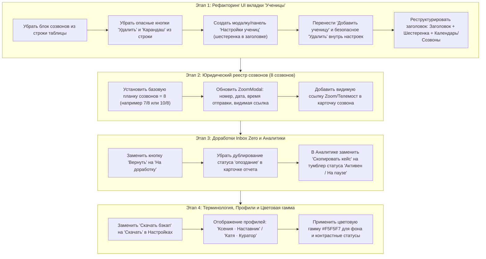

# Текстовая выжимка правок ТЗ и план реализации изменений

Документ составлен на основе детального анализа рабочей аудиозаписи разбора интерфейса и бизнес-логики трекера **«Mentor Hub»** (с участием куратора Кати и обсуждением сценариев работы наставника Ксении).

---

## 1. Полная текстовая выжимка правок ТЗ (по разделам)

### 1.1. Созвоны, ссылки и юридическая защита наставника (00:00 – 01:40, 26:10 – 26:35)
* **Проблема и юридический контекст:**  
  В договоре наставничества с ученицами зафиксировано проведение **8 консультаций/созвонов**. На практике Ксения проводит существенно больше (10+). Если ученица решает расторгнуть договор досрочно или возникают споры по возврату средств/доплате, возникает юридический риск: доказательство фактического объема оказанных услуг.
* **Требования к функционалу:**
  1. **Фиксация созвонов с метаданными:** Реестр созвонов должен содержать:
     - Порядковый номер консультации (`№ 1`, `№ 2` ... `№ 8` и далее `№ 9`, `№ 10` при перевыполнении);
     - Название консультации / этап наставничества;
     - Дата проведения;
     - Время отправки ссылки в чат Telegram;
     - **Видимая и кликабельная ссылка на видеовстречу** (Zoom / Google Meet / Яндекс Телемост).
  2. **Автовыуживание ссылок из чатов Telegram:** Возможность парсинга ссылок определенного формата (Zoom/Meet/Telemost), которые Ксения отправляет в чат ученице, для автоматического внесения в реестр созвонов.
  3. **Индикатор выполнения договора:** Всегда использовать стандартную базу **8 созвонов** (например, `7 из 8`, а при перевыполнении программы — `10 из 8` с индикацией перевыполнения плана наставником).
  4. **Доказательная база:** Возможность прикрепления подтверждения (скриншот/ссылка на сообщение в чате).

---

### 1.2. Раздел «На проверку» (Inbox Zero) (03:45 – 09:20)
* **Устранение визуального дублирования:**  
  В карточке отчета статус *«Опоздание»* отображается дважды. Необходимо убрать дублирующий бэйдж, оставить один лаконичный индикатор.
* **Персонализация / деперсонализация статуса проверки:**  
  Текст *«Принято на проверку Ксенией»* скорректировать: исключить жесткую привязку, если отчет проверяет куратор Катя (выводить динамически имя проверяющего либо нейтральное *«Принято на проверку»*).
* **Переименование кнопки отклонения:**  
  Кнопку *«Вернуть»* переименовать в **«На доработку»** (слово «вернуть» неочевидно пользователю).
* **Четкость действий проверки:**  
  Кнопки *«Одобрить»* (позитивное действие) и *«На доработку»* (требуются исправления) должны иметь четкое визуальное разделение по стилю и смыслу.
* **Цветовое разграничение отчетов:**  
  Четко разделить списки *«На проверку»* и *«Проверенные»* по цветам:
  - **Зеленый (#10B981 / #059669):** проверенные, сданные в срок, одобренные;
  - **Красный / Коралловый (#EF4444 / #F43F5E):** на доработке, просроченные, требующие внимания.
* **Логика времени сдачи:**  
  Прозрачное разделение: *«В срок»* (до установленного дедлайна 21:00) и *«Опоздание»* (после 21:00).

---

### 1.3. Раздел «Ученицы» (Таблица, Календарь и Управление) (15:15 – 26:00)
* **Проблема текущего UI:**  
  В строке ученицы сейчас перегрузка элементами («тут вообще дохера всего», «каша по UX»).
* **Очистка строки таблицы от блока созвонов:**  
  Блок прогресса созвонов под разделительной линией внутри строки ученицы (где отображались кружки 1..N и дата следующего звонка) **полностью удалить из строки**. Управление созвонами уже вынесено в отдельное модальное окно / раздел.
* **Удаление опасных действий из быстрого доступа (защита от ложных тапов):**  
  Наставник работает с iPad пальцем или стилусом. Случайный тап на иконку корзины может привести к удалению ученицы.  
  - **Иконку корзины («Удалить») и карандаша («Редактировать») из строки таблицы полностью убрать.**
* **Новая панель управления ученицами (иконка шестерёнки):**  
  - Рядом с заголовком *«Ученицы»* разместить **иконку шестерёнки (Настройки учениц)**.
  - По клику открывается чистый перечень учениц: *Имя, Telegram, Профессия/Ниша, кнопка параметров*.
  - Внутри карточки настроек конкретной ученицы наставник может отредактировать нишу, контактные данные, а в самом низу — защищенная кнопка **«Удалить ученицу»** с обязательным модальным подтверждением.
* **Перенос кнопки «Добавить ученицу»:**  
  Убрать кнопку *«Добавить ученицу»* с главного экрана таблицы — добавить её внутрь панели настроек учениц.
* **Перекомпоновка верхней навигации раздела «Ученицы»:**  
  - **1-й уровень (заголовок):** Заголовок *«Ученицы»* + иконка настроек (шестеренка) + переключатель вкладок внутри экрана: **«Календарь дисциплины»** и **«Созвоны потока»**.
  - **2-й уровень (панель управления таблицей):** Поле поиска (*«Поиск по имени или нише...»*), быстрые фильтры (*«Все»*, *«Дисциплина 95%+»*, *«Требуют внимания»*, *«На паузе»*, *«Есть созвон»*) и легенда цветовых маркеров.

---

### 1.4. Раздел «Аналитика» (01:48 – 03:40)
* **Удаление кнопки «Скопировать кейс для сторис»:**  
  Копирование неформатированного текста признано избыточным (есть полноценный визуальный предпросмотр Точки А ➡️ Точки Б). Кнопку **убрать**.
* **Добавление тумблера статуса ученицы:**  
  Вместо убранной кнопки добавить **тумблер статуса** (*«Активный трек»* / *«На паузе»*), чтобы изменять статус ученицы прямо из аналитики, не переходя в другие разделы.

---

### 1.5. Раздел «Настройки» (10:05 – 13:15)
* **Упрощение терминологии для пользователя:**  
  Кнопку *«Скачать бэкап»* переименовать в понятную пользователю кнопку **«Скачать»** (или *«Скачать данные»*), так как термин «бэкап» перегружает наставника техническим сленгом.
* **Сохранение служебных функций:**  
  Кнопки сброса к демо и параметры подключения базы данных оставить (служебный контур).

---

### 1.6. Раздел «Продвижение» и «Хэштеги» (09:20 – 10:05, 13:15 – 14:20)
* Раздел *«Продвижение»* (скрипты, шпаргалки) оставить без изменений.
* В модальном окне правил/хэштегов обеспечить наглядность обязательности сдачи черновика Reels до публикации.

---

### 1.7. Профили наставника и куратора (26:40 – 27:40)
* Четкое разграничение ролей в шапке и боковой панели:
  - **«Ксения · Наставник»** (Главный ментор);
  - **«Катя · Куратор»** (Куратор потока / Управление).
* Обеспечить сохранение единой базы данных с персональным отображением роли в текущей сессии.

---

### 1.8. Цветовая палитра и эргономика UI (30:30 – 32:05)
* **Фоновый цвет:** Замена холодного жесткого белого на мягкий нейтральный светлый оттенок **`#F5F5F7`** / **`#F8F9FA`** (стандарт Apple iOS / iPadOS, снижает утомляемость глаз).
* **Контрастный текст:** Глубокий темный оттенок (`#0F172A` / `#1E293B`).
* **Цветовое кодирование:**
  - Зеленый (`#10B981` / `#059669`) — сдано вовремя, проверено, соблюдение договора;
  - Красный (`#EF4444`) — на доработку, срыв дедлайна, удаление;
  - Янтарный (`#F59E0B`) — опоздание.

---

## 2. Комплексный план реализации изменений

---

### Детальная разбивка задач по файлам:

| Файл | Вносимые изменения |
| :--- | :--- |
| **`frontend/src/App.tsx`** | 1. Рефакторинг шапки вкладки `students`: размещение шестеренки настроек, переключателя Календарь/Созвоны, перенос поиска. 2. Очистка строки ученицы: удаление полосы созвонов и прямых кнопок удаления/карандаша. 3. Переименование кнопки *«Вернуть»* ➡️ *«На доработку»* в инбоксе. 4. Устранение дублирующего бэйджа опоздания в отчете. 5. В `analytics`: замена кнопки копирования кейса на тумблер статуса паузы/активности. 6. В `settings`: переименование кнопки *«Скачать бэкап»* ➡️ *«Скачать»*. 7. Обновление фона приложения на `#F5F5F7` и бейджей профиля (*«Ксения · Наставник»*, *«Катя · Куратор»*). |
| **`frontend/src/components/modals/ZoomModal.tsx`** | 1. Отображение базового лимита договора: **8 консультаций** (расчет `X из 8`, при превышении — бейдж *«План договора перевыполнен»*). 2. Полноценная строка записи: порядковый номер, название консультации, дата, время отправки ссылки, **открытая видимая ссылка** (с кнопкой быстрого перехода и копирования). |
| **`frontend/src/components/modals/StudentSettingsModal.tsx`** *(новый компонент)* | Выделенное окно/панель управления ученицами: список всех подопечных, редактирование ниши/телеграма, кнопка создания новой ученицы и защищенная кнопка удаления с подтверждением. |
| **`frontend/src/types.ts`** | Актуализация полей для записей созвонов (время отправки ссылки `linkSentAt`, отображение договора `contractZoomQuota: 8`). |
| **`frontend/src/mockData.ts`** | Установка 8 обязательных созвонов в демонстрационных данных для всех учениц, добавление времени отправки ссылок. |
| **`docs/CONTRACT_PISARIK_SIDORENKO.md`** & **`docs/ARCHITECTURE_SPECIFICATION.md`** | Фиксация в Приложении № 1 (ТЗ) требований по фиксации созвонов как юридического доказательства исполнения договора наставничества. |
